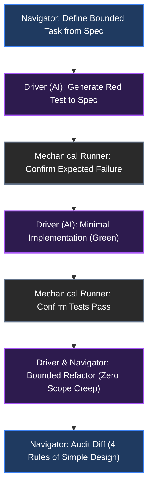

# Chapter 3 - The Terminal Loop: Writing and Refactoring

Once intent and context are established, the work moves to the terminal. In classic Extreme Programming (XP), two engineers sat at one keyboard, passing control back and forth in symmetric collaboration. In aiXP, the dynamic is fundamentally asymmetric: the AI generates code at machine speed, but possesses zero organic awareness of architectural intent.

Four disciplines govern this active pairing loop at the terminal:

- **Asymmetric Pairing:** Dividing responsibility cleanly between human intent and automated execution.
- **Test-Driven Development:** Using tests as both the outer acceptance lock and the Driver's local steering loop.
- **Bounded Refactoring:** Enforcing strict blast-radius controls and separating structural changes from behavior changes.
- **Simple Design and YAGNI:** Pruning machine-speed over-engineering before it enters trunk.



---

## Asymmetric Pairing

Asymmetric Pairing assigns mutually exclusive, non-overlapping responsibilities: the human engineer navigates intent, boundaries, and verification, while the AI Driver generates execution within bounded constraints.

### The Failure Mode: Context Overfitting and Passive Drift

When an engineer abdicates navigation and attempts to "co-type" with an agent inside a single marathon session - asking open-ended questions like *"How should we design this feature?"* or iterating blindly through runtime errors - architectural coherence degrades rapidly. The agent generates plausible, verbose abstractions to solve hypothetical problems the system does not have. Overwhelmed by streaming diff volume, the human slips into passive observation, skimming changes rather than applying critical review.

Underneath that human fatigue sits a mechanical failure mode in the model itself: **prompting isn't what fails over a three-hour session; the accumulated context is what fails.** The model's weights are frozen, but its working memory is not. An unpruned context window acts like an over-trained neural network in real time: it overfits to its own dead ends, compiler errors, and discarded plans. Attention dilutes, hallucinations compound, and the agent begins solving problems against a reality that exists only in its polluted session history.

### The Mechanism

In classic XP pairing, the Navigator caught typos, suggested variable names, and anticipated the next function. With an AI pair partner, generation outpaces manual line-by-line proofreading. Our responsibility as Navigator moves up the abstraction ladder:

- **The Human Navigator:** Maintains the mental model, defines task boundaries from the spec, polices architectural invariants, audits selected diffs and tests, probes edge cases, and retains exclusive authority to merge or revert changes.
- **The AI Driver:** Generates implementations, drafts test cases to specification, runs local build and test commands, and executes scoped refactoring passes within explicit boundaries.

The pairing cadence relies on short, bounded round-trips: the Navigator issues a constrained instruction, the Driver executes, the mechanical runner validates, and the Navigator audits Acceptance Test before moving to the next step. Once a bounded task is complete and committed, the worker session can be cleared or closed so the next task starts with a clean working memory.

Crucially, Asymmetric Pairing puts [Pillar 3 (Contracts govern what, not how)](01.01.50-manifesto.md#pillar-3---contracts-govern-what-not-how) into daily practice at the keyboard. When I brief the Driver, I specify *what* invariants must hold and *which* files are in scope, rather than dictating procedural pseudocode. Because the Driver is not trapped inside my procedural assumptions, its implementation serves as an independent second opinion: when I audit the resulting diff, I frequently find that the model chose a cleaner standard-library primitive or functional composition than I would have typed by hand.

<!-- TODO: This section is actually incorrect by a single level - usually the agent I work directly with will be the same that is intimately aware of the spec, and that agent will launch a sub-agent to do the implementation -- in that situation, diffs are fully examined and code reviewed.  There's no way for the human to keep up with the volume to diffs and it's dis

### Perception-Gated Work: When the Loop Is Human Judgment

Not every engineering task can be verified by a headless test runner. Visual layout, typography contrast, animation timing, shader aesthetics, and mobile touch feel belong to a distinct category: **Perception-Gated Work** - work whose verification loop is human sensory judgment rather than a binary console output.

Pretending that unit tests or DOM snapshots cover sensory quality is one of the most common sources of AI frontend frustration. In Perception-Gated Work, the AI stays in the loop, but the division of labor adapts through two recurring sub-patterns:

- **Instrumented Tweaking:** Instead of prompting the agent twenty times in a row with *"make the animation slightly faster"* or *"darken the shadow by 5%,"* have the Driver build an interactive parameter knob, debug slider, or CSS variable control directly into the dev build. The AI performs the meta-work of building the instrument, allowing you to dial in the exact visual or tactile feel in real time without round-tripping through the prompt window.
- **Pseudocode-Down (The Intentional Exception):** While Pillar 3 forbids procedural micromanagement for general feature work, heavy mathematical or perceptual algorithms inside perception-gated work (such as a custom optical falloff curve or audio filter) sometimes invert that rule. Once you have worked out the exact mathematical formula or algorithmic shape, you hand that formula to the Driver at the pseudocode level and let it handle the mechanical translation into target syntax and shader uniforms.

### Trade-Offs and Boundary Conditions

- **Cost:** Asymmetric pairing demands active, critical concentration. You cannot zone out while tokens stream across the console; every generated line that enters the diff must earn its keep.
- **When NOT to use:** Routine, deterministic housekeeping (such as mechanical dependency bumps or uniform syntax migrations across files) does not require interactive turn-by-turn pairing; those tasks can be delegated to headless scripts or single-shot background commands with post-hoc diff review.

---

## Test-Driven Development (TDD): The Local Feedback Loop

Where Acceptance Test-Driven Design (ATDD) defines the outer boundary of truth from the spec, **Test-Driven Development (TDD)** is the immediate, local feedback loop at the terminal that keeps implementation honest step by step from red to green.

### The Failure Mode: Functional Hallucinations and Post-Hoc Tests

Because code generation is computationally cheap, an unconstrained agent prompted to *"add feature X and write unit tests"* will happily generate both the implementation code and a matching suite of green unit tests in a single turn.

When an agent writes implementation code first and generates tests afterward, it writes tests that conform to its own internal assumptions. The tests prove only that the code does what it does, not what the specification requires. If the implementation contains an off-by-one calculation, a race condition, or a missing boundary check, the post-hoc test suite dutifully asserts that broken behavior as baseline truth. The suite is 100% green, yet the feature is functionally hallucinated.

Worse, expecting a human reviewer to catch those domain errors by reading through hundreds of lines of generated unit-test mocks line by line invites immediate vigilance fatigue. The Navigator cannot be a human linter for the AI's internal unit tests.

### The Mechanism: Outer Locks and Inner Steering

As software delivery pioneer Dave Farley has observed, generative AI is a high-velocity code generator that requires deterministic feedback loops as non-negotiable governors; without them, machine speed simply produces unverified technical debt faster.

To keep verification rigorous without drowning the human reviewer in unit-test noise, aiXP separates the terminal test loop into two distinct layers:

1. **The Outer Red Lock (Acceptance and Bug Reproduction):** Before any production code is modified for a feature or bug fix, the outer acceptance test or bug-reproduction test is written against the micro-spec and executed mechanically. It must fail (Red) for the exact expected reason. Once confirmed failing, that test file is locked: the Driver is not allowed to weaken or delete the assertion while implementing the fix.
2. **The Inner Driver Loop (Unit TDD):** While working to turn that outer test green, the Driver uses classic unit-level TDD (Red -> Green -> Refactor) as its internal steering mechanism to build out helper functions and internal modules. Because the outer acceptance gate and final diff audit guard the boundary, the human Navigator does not need to micromanage the Driver's internal unit scaffolding turn by turn.

### Field Case: Mandatory Red-Green Bug Reproduction

In both `QuKi-Notes` and `BojuBot`, every bug fix is governed by a strict rule in `CLAUDE.md`: *All bug fixes require red/green tests - a failing test that reproduces the bug, then the fix that makes it pass.*

Early on, if I reported a bug in the terminal without enforcing that sequence, the agent would immediately patch the source file, write a passing test afterward, and declare victory. Occasionally, the bug wasn't actually fixed - or the new test would have passed even without the patch because the test setup missed the real trigger condition.

Enforcing the mechanical Red step first eliminates that blind spot:

1. **Prompt for the reproduction test only:** Direct the Driver to write the test that reproduces the reported failure without touching the implementation file.
2. **Verify the Red failure in the runner:** Confirm that the test fails with the exact stack trace or assertion mismatch seen in the bug report. A reproduction test that passes against unpatched code proves nothing.
3. **Implement the minimal Green fix:** Only after the failure is mechanically confirmed does the Driver touch the production file to turn the test green.

### Trade-Offs and Boundary Conditions

- **Cost:** Requires discipline to pause and run the failing test before allowing the agent to write the fix, even when the one-line patch seems obvious.
- **When NOT to use:** Purely visual tweaks in Perception-Gated Work cannot be asserted via unit tests, though any underlying state logic or data transformation supporting the UI must still be covered by deterministic tests.

---

## Bounded Refactoring

Bounded Refactoring strictly limits AI modifications to pre-approved scope, isolating structural cleanup from behavioral changes and rejecting unrequested "drive-by" edits.

### The Failure Mode: Scope Creep and Bloated Diffs

In manual programming, typing effort acts as a natural brake against unrequested refactoring. With an AI pair partner, generation is free, and models have no built-in incentive to minimize diff size.

When asked to fix a bug or add a single parameter, an unconstrained agent will routinely reformat neighboring methods, rename variables in adjacent files, swap working patterns for its preferred idioms, and reorder imports. As Kent Beck notes in [*The Genie Eats The Seed Corn*](https://tidyfirst.substack.com/p/augmented-coding-and-design), AI assistants will also happily take structural shortcuts to satisfy an immediate prompt if boundaries aren't policed. Both habits - unprompted drive-by edits and silent structural shortcuts - produce bloated, noisy diffs that obscure the core change and introduce silent regression risk.

### The Mechanism

In aiXP, refactoring discipline shifts from encouraging code movement to bounding blast radius:

- **Tidy First, or Tidy After - Never During:** Following Kent Beck's *Tidy First?* principle, structural refactoring passes and functional behavior changes must live in separate commits. Never combine a structural refactor and a feature change in the same prompt or pull request.
- **Explicit File and Scope Locks:** Prompts explicitly name which files the Driver may modify and what is off-limits. If the Driver spots something outside the task's scope that looks worth cleaning up, it is instructed to report the observation in its summary rather than fixing it in place.
- **Diff Screening:** The Navigator audits every diff against a single gate: *"Did I authorize this specific line to change?"* Any unrequested modification is reverted immediately.

### Production Artifact: Pure-Refactor Seam Isolation (BojuBot)

Look back at the `BojuBot` multi-backend spec in [Chapter 2](01.02.50-intent-and-context.md#production-artifact-multi-backend-feature-design-spec-bojubot). Before adding support for a second CLI backend (Antigravity CLI), the existing codebase was tightly coupled to Claude Code.

Attempting to refactor the architecture and implement the new backend in the same terminal loop would have produced an unreviewable, high-risk diff across the entire plugin. Instead, **Phase 1** was scoped as a strictly bounded, zero-behavior-change refactor:

```markdown
| Phase | Scope | Shippable on its own |
| --- | --- | --- |
| 1 | AgentBackend seam; Claude Code moved behind it with zero behavior change | Yes (pure refactor) |
| 2 | Antigravity backend MVP: chat, resume, tools, Standard/Full/Read-only, denial card, models, effort, history | No, internal milestone |
```

During Phase 1 at the terminal, the Driver's boundary was absolute: extract the `AgentBackend` interface, move the existing Claude Code implementation behind that seam, keep every existing test passing, and introduce **zero functional behavior changes**. Only after that pure structural refactor was verified, reviewed, and merged did Phase 2 begin adding new behavior.

---

## Simple Design and YAGNI

Simple Design and You Aren't Gonna Need It (YAGNI) defend the codebase against machine-speed over-engineering and premature abstraction.

### The Failure Mode: Three-Second Boilerplate Bloat

Because LLMs are trained on massive enterprise repositories and framework-heavy codebases, they exhibit a strong bias toward defensive over-engineering. Prompted for a simple configuration lookup, an agent will readily generate generic repository interfaces, abstract factories, dynamic plugin registries, and speculative extension points.

When writing 200 lines of boilerplate took a human engineer two hours, effort naturally discouraged unnecessary complexity. When generating 200 lines takes three seconds, that friction vanishes. Left unchecked, the codebase fills with speculative ceremony that nobody asked for and that every future session has to read, maintain, and work around.

### The Mechanism: Kent Beck's Four Rules as a Diff Filter

In [*Lean Software Development*](https://www.poppendieck.com/), Mary and Tom Poppendieck framed software bloat as manufacturing waste. In aiXP, architectural waste is an output-volume problem.

During every diff audit at the end of a terminal round-trip, the Navigator applies **Kent Beck's Four Rules of Simple Design** as an active filter on generated code:

1. **Passes all tests:** All mechanical and acceptance verification gates are satisfied.
2. **Reveals intent:** Names, control flow, and data structures are direct and legible without layers of indirection.
3. **No duplication:** Accidental duplication of logic or knowledge is eliminated (while recognizing that a little clear duplication is far cheaper than the wrong premature abstraction).
4. **Fewest elements:** Any speculative interface, unused parameter, wrapper class, or hypothetical extension point not required by the current spec is deleted before commit. If a lookup requires a plain map, reject the abstract factory.

### Trade-Offs and Boundary Conditions

- **Planning Ahead vs. Speculative Bloat:** Enforcing YAGNI in the terminal does not mean building fragile shortcuts. As established in [Chapter 2](01.02.50-intent-and-context.md#running-the-spec-session-boundaries-and-pitfalls), we plan ahead in the spec for requirements we can see coming so we don't paint the architecture into a corner. The rule is simple: *design clean seams for known requirements in the spec, but forbid the Driver from inventing unrequested abstractions in the code.*

---

Running this four-part loop at the terminal keeps individual changes small, test-driven, and structurally clean. Yet even when every round-trip is bounded, reviewing diffs at machine speed rapidly taxes the most fragile component in the loop: human attention. Sustaining high-velocity pairing without slipping into rubber-stamp approvals requires structuring how agents are organized and how we budget our own cognitive stamina.
