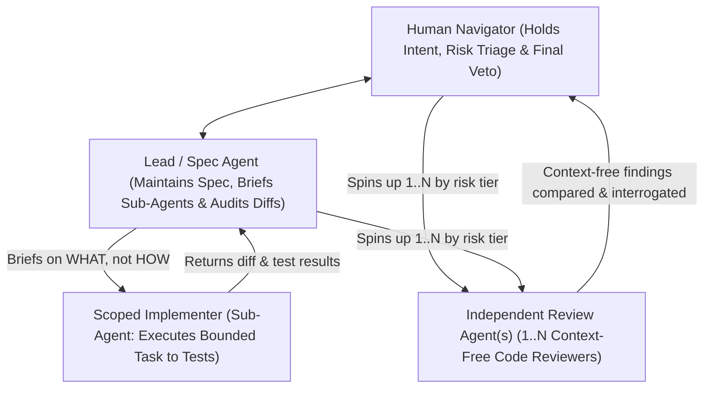

# Chapter 4 - Judgment, Roles, and Cognitive Budgeting

When AI tools handle implementation at machine speed, human judgment does not vanish; it becomes the primary constraint in software delivery. An engineer fatigued by streaming diffs will inevitably rubber-stamp changes, overlook architectural drift, and allow silent regressions to compound.

Four practices safeguard and focus human judgment:

- **Agent Role Topology:** Organizing multi-agent workflows into distinct, heirarchical roles with clear checks and balances.
- **Executive Code Review:** In-depth evaluations of source, free from contextual noise, to ensure code speaks for itself.
- **Vigilance Budgeting:** Protecting human cognitive stamina and focus through session caps, velocity governance, and cognative load balancing.
- **Prioritization Authority:** Explicitly firewalling scheduling, trade-off decisions, and scope boundaries to the human Navigator.

---

## Agent Role Topology

Agent Role Topology structures agent sessions into distinct, but flexible, specialized roles with explicit authority boundaries, rejecting the chaos of the undifferentiated agent swarm.

### The Failure Mode

When engineers first adopt autonomous agent tooling, the common impulse is to launch an "agent swarm" - unleashing multiple general-purpose agents simultaneously on a repository with instructions like *"Fix all open backlog issues."* Without explicit role boundaries, agents step on each other's branches, perform contradictory refactors, invent divergent architectural patterns, and overwhelm the human with unreviewable change volume.

<-- TODO: lets brainstorm the full, real failuremodes here - this happens with swarms and also when even a smaller, controlled number of agents just try to do too much in a single steps - looking through all my mistakes.md files should be abgood starting point.  fudging tests, repeated methods, god classes, implememting undiscussed and unknown decisions.  dead code, implementing functiona that 'soumd good' on paper, but don't work in real UX, etc -->

### The Mechanism

aiXP maintains a flat, disciplined topology centered on three functional roles that scale with the risk of the change:



1. **Lead / Spec Agent:** Holds the overarching specification, Architecture Decision Records (ADRs), and context artifacts. It works directly with the human Navigator to break problems into discrete, bounded tasks, dispatches Scoped Implementers, and performs the primary line-by-line diff and test verification against the spec when a sub-agent returns.
2. **Scoped Implementers (Sub-Agents):** Subordinate, ephemeral sessions that receive a single bounded task with explicit file boundaries and acceptance criteria. They write the reproduction or acceptance test, implement the minimal fix, and return their work to the Lead Agent. Because their context windows are discarded after the task, their trial-and-error noise never pollutes the Lead session.
3. **Independent Executive Reviewer(s):** Fresh, isolated agent sessions given zero access to specs, ADRs, or prior conversational history. Their only input is the raw code and diff. Depending on the blast radius and risk of the change, I may spin up one or several independent review agents and cross-compare their findings.

### Production Artifact: Sub-Agent Workflow and Load-Bearing Briefs (`QuKi-Notes` & `CambrianaCore`)

Across production repositories (`ScooterGitTemplate`, `QuKi-Notes`, and `CambrianaCore`), `CLAUDE.md` codifies the exact handoff between the parent (Lead/Spec) session and its implementation sub-agents, including the **load-bearing vs. reversible** test for what belongs in a brief:

```markdown
## Sub-Agent Workflow

- Brief sub-agents on **what** to achieve and the acceptance criteria, not **how** to write it (avoid prescribing step-by-step code or implementation details unless a specific constraint requires it).
  - **Load-bearing vs. reversible:** before leaving a choice to a sub-agent, ask whether changing it later would cascade into sibling components. If yes, it's load-bearing - state it in the brief. If it's local and reversible, delegate freely.
- The parent agent owns quality control and git workflow:
  - Review the sub-agent's diff before committing or opening a PR.
  - If the sub-agent deviated from the brief or left something incomplete, send it back with specific feedback rather than patching over it silently.
```

---

## Executive Code Review

Executive Code Review evaluates diffs with zero conversational context, forcing the code to speak entirely for itself.

### The Failure Mode

When the engineer (or the Lead Agent) who paired on a feature reviews the resulting pull request, they bring immense conversational memory into the review. They remember what the prompt requested, how the implementation was justified in chat, and which compromises were debated along the way. That memory blinds the reviewer: the implementation appears obvious because the explanation is fresh in working memory. Three months later, another engineer (or a fresh AI session) opens the file and finds it incomprehensible because the rationale lived in a transient chat session rather than in the code itself.

### The Mechanism

A human engineer who just spent an hour designing a feature cannot magically un-remember that conversation to read the diff like an outsider. Executive Code Review solves this by delegating context-free scrutiny to fresh, isolated review agents and shifting human effort to interrogating their findings:

- **Context-Free Review Agents:** One or more fresh agent sessions are spun up with zero access to the spec session, chat history, or ADRs. They inspect the raw diff as outside auditors who just cloned the repository. If a function cannot be understood without reading the prompt that generated it, or if an edge case relies on an unstated conversational assumption, they flag it.
- **Cross-Comparison and Deep Interrogation:** On high-risk or wide-swath changes, I run multiple independent review agents, compare their reviews side by side, and comb through their language alongside selective diff checks and heavy acceptance tests. Whenever a review raises a question or two reviewers disagree, I ask for clarifications and pull on the thread until I completely understand the PR before committing or merging.

```markdown
You are reviewing this diff with no access to specs, ADRs, or prior conversation.
Read only the code and tests in front of you. Do not ask for documentation.

Report, line by line, with no summarizing shortcuts:
- Security vulnerabilities, unvalidated inputs, or boundary assumptions
- Dead, unreachable, or redundant code paths
- Missing error handling, resource leaks, or unhandled rejections
- Tautological tests (tests that mock away the system under test or cannot fail)
- Any logic whose intent is not immediately clear from the code itself
```

---

## Vigilance Budgeting

Vigilance Budgeting treats human attention as a scarce engineering constraint, recognizing that critical verification degrades rapidly under sustained cognitive load.

### The Failure Mode

Generating 500 lines of code by hand takes hours of typing, giving the brain natural pauses to reflect, catch edge cases, and evaluate design choices. Generating 500 lines with an AI takes thirty seconds.

If you attempt to personally read forty consecutive 500-line diffs line by line, vigilance fatigue is guaranteed. Long before the fortieth diff, a human reviewer stops reading code critically and begins scanning for general shape, subconsciously rubber-stamping the output. Recognizing that reviewing forty consecutive raw diffs is exhausting is the exact reason I don't do it.

### The Mechanism

aiXP protects human attention as a finite, non-renewable engineering resource through two mechanisms:

1. **Offloading Routine Line-by-Line Auditing:** As established in [Chapter 3](01.03.50-terminal-loop.md#the-mechanism-one-level-down-and-risk-triage), we do not burn human working memory acting as a syntax linter on every routine implementation turn. By delegating first-pass line-by-line diff review to the spec-aware Lead Agent and context-free Executive Review Agents, we reserve human attention for the work that requires human judgment: risk triage, spec invariants, acceptance testing, selective seam inspection, and fine-toothed interrogation of review findings.
2. **The Working Memory Wall and Session Ceilings:** Even when routine diff reading is offloaded, high-level architectural triage and PR interrogation are cognitively demanding. Cognitive research (notably Nelson Cowan's working-memory chunking limits) demonstrates that humans can reliably juggle approximately four active items at once. When concurrent tasks, review threads, or session duration exceed that ceiling, human judgment degrades just as surely as it does under raw diff volume.
3. **Token Burn as an Anti-Metric:** High token consumption and marathon sessions signal prompt thrashing and cognitive overload, not velocity.

### The Concrete Artifact

The Navigator's vigilance boundary rule:

> [!WARNING] The Vigilance Bankruptcy Rule
> If you find yourself about to commit or merge a pull request without fully understanding what it changes, how its tests prove correctness, and why every review finding was resolved, your vigilance budget is bankrupt. Stop generation immediately. Do not merge on faith; step away from the terminal and resume with a fresh head.

---

## Prioritization Authority

Prioritization Authority reserves scheduling, backlog prioritization, and architectural trade-offs exclusively for the human Navigator.

### The Failure Mode

When developers grant AI agents broad autonomy over issue trackers and backlogs, agents naturally prioritize tasks that are computationally easy rather than strategically valuable: rewriting tests, updating README files, or refactoring utility functions that were not causing issues. Worse, agents lack business accountability. An AI agent cannot weigh the trade-off between customer churn and technical debt because it suffers no consequences when a system fails.

### The Mechanism

In aiXP, authority and accountability are indivisible:

- The AI may analyze dependencies, identify technical debt, and suggest task decompositions.
- Only the human Navigator has the authority to schedule work, assign priority, or approve compromises.
- AI is an implementation multiplier, not an engineering manager.
