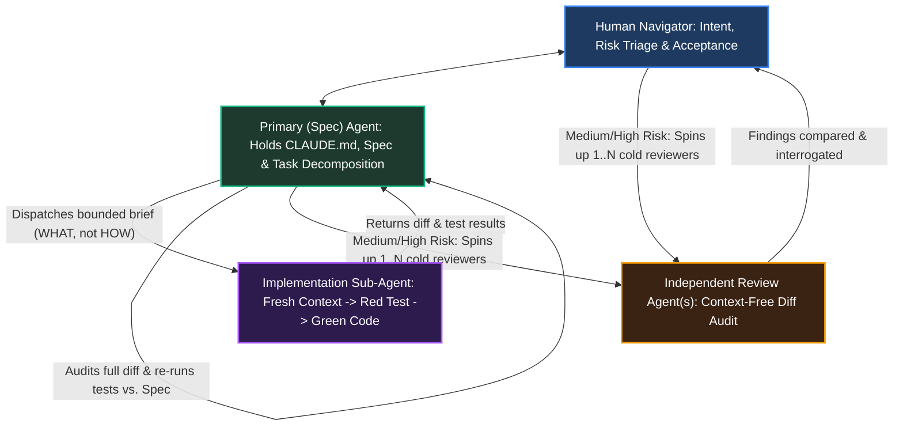

# Field Protocol - The Loop in Practice

The preceding chapters laid down the pillars and practices of aiXP: how to ground intent and context before writing code ([Chapter 2](01.02.50-intent-and-context.md)), how the terminal loop operates one level down through risk triage ([Chapter 3](01.03.50-terminal-loop.md)), and how agent roles, context-free reviews, and vigilance budgeting protect human judgment ([Chapter 4](01.04.50-judgment-and-roles.md)).

In theory, those practices look neat and linear. In practice, a workday is a continuous triage game.

When you have an open issue or feature spec in front of you, you are constantly deciding how much ceremony the change warrants, which decisions are load-bearing, when to let the Primary Agent and its Sub-Agents run, and when to step in personally with acceptance tests, selective diff checks, and multiple independent review agents.

This field protocol walks through how those pieces come together on real production work.

---

## Setting Up the Session: Primary Agent, Sub-Agent Dispatch, and Risk Triage

The most common mistake engineers make when adopting agent tooling is trying to do everything inside a single marathon chat window - brainstorming architecture, researching libraries, writing tests, generating 500 lines of implementation, and debugging thirty turns of compiler errors in the same context. By hour two, that context window is so overfitted to discarded plans and stack traces that the model begins hallucinating fixes against code that no longer exists.

At the opposite extreme, trying to personally hand-prompt every unit test and read every single line of every generated diff yourself leads straight to vigilance bankruptcy.

To keep context clean without drowning in diff volume, the working session operates through **Primary-to-Sub-Agent dispatch** calibrated by risk:

1. **The Primary (Spec) Session:** My main session holds `CLAUDE.md`, the architecture notes, and the active specification. We clarify intent, surface domain gaps, lock load-bearing seams, and break the work into bounded steps.
2. **Isolated Sub-Agent Dispatch:** Except on small, low-risk edits where I stay in a direct loop and watch the diff and tests myself, the Primary Agent does not grind through the implementation loop in its own window. Instead, it launches a fresh **Sub-Agent** with a scoped task brief: which files are in scope, what acceptance criteria and red/green tests must be satisfied, and what is explicitly out of scope. Once the Sub-Agent finishes, its disposable context window is discarded so its trial-and-error noise never pollutes the Primary session.
3. **Layered Review by Risk Tier:**
   - On **small, low-risk changes**, there is less internal agent-on-agent oversight, and the diff and unit tests are small enough for me to comprehend completely - so I review the diff and tests directly and often run the test runner by hand.
   - On **standard bounded tasks**, the Primary Agent inspects the Sub-Agent's full diff line by line, re-runs the test suite independently against the spec, and sends any deviations back to the Sub-Agent before bringing the result to me.
   - On **high-risk or wide-swath changes**, I spin up multiple independent Review Agents (with zero conversational context), run deeper and slower automated verification suites, perform selective diff reviews on load-bearing seams, and comb through the competing review reports with a fine-toothed comb until I completely understand the PR before committing.

---

## Living Specs and Institutional Memory

An aiXP spec is not a static binder, nor is it an append-only diary of historical debates. Across production repos (`BojuBot`, `QuKi-Notes`, and `CambrianaCore`), specs and context files follow three operational rules:

- **Explicit Decision Statuses:** Every requirement or design choice in an active spec is in one of three states:
  - **Decided:** Reviewed and locked with the human Navigator; stated directly as current truth without historical narrative.
  - **`[Proposed - unconfirmed]`:** A reasonable default filled in by an agent during spec drafting that has *not* yet been explicitly confirmed by the human. Implementation sub-agents treat `[Proposed - unconfirmed]` items as open flags to surface, never as locked contracts.
  - **Open:** A known question or deferred requirement that carries explicit design obligations (for example, `CambrianaCore` `SDD-05`: deferring custom allocator hooks while locking the obligation that *"every error condition must leave the context clean for reuse"*).
- **Same-Commit Context Stewardship:** Whenever a PR changes a command, file path, architectural seam, or workflow rule, `CLAUDE.md` and the relevant spec are updated in the **same commit** - overwriting obsolete descriptions rather than appending history.
- **No-Blame Operational Learning (`mistakes.md`):** When an agent or human hits a recurring trap - such as a subtle framework quirk, a flaky test pattern, or a spec ambiguity - we log it in `notes/dev/mistakes.md` or git-tracked agent memory (`notes/dev/memory/`). Those logs exist to adjust our guardrails and keep the mistake from repeating, never to keep score.

---

## Briefing What, Not How: The Load-Bearing Litmus Test

When the Primary Agent briefs an Implementation Sub-Agent, it applies **[Pillar 3: Contracts govern what, not how](01.01.50-manifesto.md#pillar-3-contracts-govern-what-not-how)**.

Dictating step-by-step procedural code in a sub-agent brief turns the sub-agent into an echo chamber: it implements the supervisor's exact assumptions (including hidden bugs) and misses cleaner standard-library primitives. Conversely, leaving a cross-cutting interface unspecified causes sibling components to break.

As codified in `QuKi-Notes/CLAUDE.md` and `CambrianaCore/CLAUDE.md`, the dividing line is the **load-bearing vs. reversible** test:

> Before leaving a choice to a sub-agent, ask whether changing it later would cascade into sibling components. If yes, it is **load-bearing** - state it in the brief. If it is local and reversible, delegate freely.

When the Sub-Agent returns its diff, the Primary Agent does not trust the Sub-Agent's self-reported summary at face value. It pulls `git diff`, checks every modified line against the brief and Kent Beck's Four Rules of Simple Design, and re-runs the test suite with a fresh command.

---

## Walking a Real Ticket: Multi-Round Verification in `QuKi-Notes` (PR #350)

To see how Spec-to-Sub-Agent dispatch, independent diff review, and human acceptance testing interact under real conditions, let us walk through an actual multi-issue bug fix from `QuKi-Notes` (Phase 3.60, shipped in PR #350 across issues `#335`, `#266`, `#336`, `#352`, and `#354`).

<!-- TODO: Review whether you want to keep this real QuKi-Notes PR #350 walkthrough as the centerpiece here, or pair/replace it with another specific ticket from BojuBot or CambrianaCore. -->

### The Problem Surface

In `QuKi-Notes`, notes open in **reading mode** (soft keyboard dismissed, formatting toolbar hidden) until the user taps to edit. Three interacting defects were degrading the mobile experience on Android:

1. **Reading-Mode Disruption (`#335`, `#266`):** Tapping a task-list checkbox (`- [ ]`) to toggle it while in reading mode caused the line to expand into raw Markdown source, scrolled the document to the top, and popped open the soft keyboard. Similarly, long-pressing or double-tapping to select text in reading mode eagerly requested focus and popped open the keyboard.
2. **Tiny Checkbox Hit Targets (`#336`, `#352`):** Tapping slightly to the left of a checkbox on a phone screen missed the toggle target and placed the text cursor instead.

### Round 1: Sub-Agent Dispatch and Root-Cause Isolation

The Spec session briefed the Implementation session on the behavioral invariants: toggling a checkbox or selecting text in reading mode must never open the keyboard, reveal raw source, or reset scroll position, and must be backed by failing-then-passing widget tests.

Instead of slapping a boolean flag onto the UI screen, the implementation traced the root causes in `markdown_live_editor`:
- Checkbox toggling was calling `setValue()`, which had a hardcoded selection-reset-to-0 meant for loading a brand-new document. Extracting `setValuePreservingSelection()` kept the edit in place without moving the cursor or scrolling.
- Text selection in reading mode was triggering `_onTapDown`'s eager `requestFocus()`; reversing that focus request post-hoc when a gesture resolved as a selection kept reading mode intact.

The Spec session pulled the diff, verified the new widget tests, and confirmed Round 1 passed all automated checks.

### Round 2: When a Green Review Meets Physical Acceptance Testing

Next came the widened hit-test zone for checkboxes (`#336`, `#352`). This is a classic example of why automated tests and agent code reviews cannot replace human acceptance testing on physical hardware:

- **Attempt 1 (Agent Review Blind Spot):** The sub-agent widened the checkbox hit-test rect slightly. When the Spec session reviewed the diff and test assertions, it verified that the new hit zone *"did not overlap a neighboring line"* and approved the round for device testing.On a real phone, tapping the far-left margin still missed the checkbox. Why? Because *"doesn't overlap a neighbor"* is not the same invariant as *"is wide enough where a human thumb lands."*
- **Attempt 2 (The Padding Seam):** A second pass anchored the hit zone at the row's text-origin left edge (`x = 0` of the text run). Device testing showed it *still* missed far-left taps.
- **Attempt 3 (The Real Boundary):** Inspecting the widget layout geometry revealed the culprit: the editor had `12px` of internal content padding sitting to the left of the text origin - the exact strip of glass where a user's thumb naturally aims when tapping a left-margin checkbox. Anchoring the hit-test zone all the way to the widget's outer edge (including the `12px` padding) finally made physical taps reliable across both top-level and nested lists.

### Round 3: Uncovering a Hidden Nested-List Bug and a Full-Suite Race Condition

While testing the widened hit targets on indented sub-lists, physical acceptance testing uncovered a separate bug (`#354`) that was not in the original ticket scope: even when a tap hit a **nested** checkbox squarely, the checkbox did not toggle.

1. **The Indentation Offset Bug:** Tracing `_onCheckboxToggle` showed that it read the `- [ ]` marker assuming the marker started at `MdElement.start`. For top-level items, that was true. For nested items, `MdElement.start` was the *line's* start (before leading indentation spaces or tabs), so the toggle logic was reading whitespace instead of the bracket! Skipping leading whitespace before reading the marker fixed nested toggling, and a new red/green test locked it in.
2. **The Full-Suite Contention Flake:** When running the complete test suite to verify the branch, an unrelated storage test failed intermittently - never in isolation, only under full-suite load. Rather than shrugging it off as "just a flaky test" and re-running CI until it turned green, the agent root-caused it to two genuine concurrency hazards: real disk-write latency under full-suite contention and a transient Windows file-locking exception during the storage layer's `write-temp-then-rename` atomic save. Adding a bounded poll-and-retry loop and verifying with **three consecutive clean full-suite runs** closed the flake permanently.

---

## Why This Loop Scales Without Burning Out the Human

Look at where human energy was spent across that ticket - and where it was *not* spent:

- I did **not** sit in a terminal typing regexes or reading 1,500 lines of Flutter `RenderBox` coordinate boilerplate line by line on every intermediate attempt. The Spec Agent and Implementation Sub-Agent handled the tactical code audits and unit-test verification.
- Instead, my attention stayed focused on the high-leverage boundaries that only a human Navigator can own: **acceptance testing on physical hardware** (catching the `12px` padding gap that looked fine in unit tests), **insisting on root-cause fixes over workarounds** (refusing to ignore the full-suite Windows file-rename flake), and **verifying that the final PR was completely understood before merge**.
