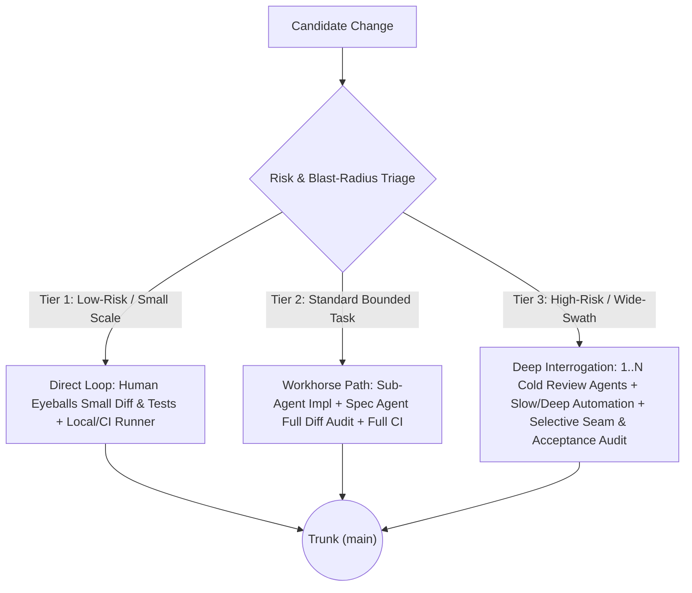

# Chapter 5 - Verification Strategy and Integration

In traditional development, testing was often treated as a late-stage tax that slowed down feature delivery. In aiXP, that dynamic inverts: when code generation costs approach zero, verification becomes the throughput of the pipeline.

Four practices structure testing and continuous integration into an automated verification engine:

- **The Verification Bottleneck:** Aligning development throughput with automated verification capacity.
- **The Four Testing Tiers:** Layering defenses from unit tests to schema contracts and hardware gates.
- **Continuous Integration and Risk-Tiered Merge Authority:** Calibrating merge rigor against blast radius.
- **Machine-Speed Regression Suites:** Converting bug reports into permanent, automated regression locks.

---

## The Verification Bottleneck

Eliyahu Goldratt's *Theory of Constraints* dictates that system throughput is governed strictly by its most constrained resource. Flooding a system upstream of its bottleneck produces inventory pileup, not finished goods.

### The Failure Mode

When engineers first adopt generative coding tools, initial focus centers on typing speed: scaffolding services, generating boilerplate, and opening massive pull requests. But without automated verification harnesses, downstream queues stall. Review backlogs swell, QA teams fall behind, and production regressions multiply. The team optimized code generation - which was never the bottleneck - and flooded the true constraint: human verification capacity.

### The Mechanism

In aiXP, verification and judgment are recognized as the primary constraints:

- **Tests are Throughput:** A fast, comprehensive automated test suite is the only mechanism that allows an engineer to safely merge high volumes of generated code.
- **Zero-Trust Generation:** All AI-generated output is treated as unverified candidate code until mechanical test harnesses prove it satisfies acceptance criteria.
- **Fast Feedback Loops:** Tests must execute in seconds, giving the human Navigator immediate, deterministic feedback before diffs are accepted into trunk.

---

## The Four Testing Tiers

Historically, maintaining a comprehensive multi-tier test ladder required dedicated QA teams that small shops could not justify. Automated test generation flattens this cost, making disciplined testing tiers practical for a solo engineer.

### The Ladder Architecture

1. **Unit Tests:** The smallest possible scope, testing isolated functions and pure logic. As detailed in [Chapter 3](01.03.50-terminal-loop.md), unit tests are written *before* implementation via Test-Driven Development (TDD) to drive AI generation.
2. **Integration Tests:** Verify that isolated components interact correctly across internal boundaries (e.g. verifying that a service properly queries the database layer or that an API controller returns the expected JSON envelope).
3. **Contract and Schema Tests:** Explicitly validate data payloads against defined schemas (OpenAPI, GraphQL, or Protobuf contracts). AI models excel at generating plausible code that subtly violates field names or nullable types; contract tests prevent these silent mismatches.
4. **End-to-End (E2E) and Perception-Gated Verification:** Validate user journeys across the full running stack. For visual or tactile interfaces where unit automation is impossible, verification shifts to human perception-gated passes and staged internal dogfooding.

---

## Continuous Integration and Risk-Tiered Merge Authority

In aiXP, Continuous Integration and merge ceremony operate as a risk-tiered triage framework: the blast radius of a change and the stakes of the project dictate the verification gates required to commit and merge it.

### The Failure Mode

If every two-line tweak in a personal utility requires a multi-agent review board, development stalls under ceremony bloat. Conversely, if wide-swath architectural changes merge based on shallow unit tests and a skimmed summary, regressions slip into trunk undetected.

### The Mechanism

aiXP pairs branch and CI discipline with the three-tier risk-triage spectrum established in [Chapter 3](01.03.50-terminal-loop.md#the-mechanism-one-level-down-and-risk-triage):

- **Tier 1 (Low-Risk / Small-Scale):** Small, local changes where no independent review sub-agents are spun up. Because there is less internal agent-on-agent oversight at this scale - and because the diff and unit tests are small enough to comprehend completely - the human Navigator eyeballs the small diff and tests directly and often runs the test runner by hand. (In explicitly low-stakes personal utilities like `RepoWatch`, `CLAUDE.md` even authorizes committing straight to `main` once Playwright and lint checks pass.)
- **Tier 2 (Standard Bounded Feature / Fix):** The everyday workhorse path. Implemented by an isolated Sub-Agent, audited line by line against the spec by the Primary Agent, and gated on a full green CI run (typecheck, lint, unit, and integration suites) plus human acceptance verification before PR merge.
- **Tier 3 (High-Risk / Wide-Swath / Load-Bearing):** Storage contracts, cross-compiler determinism (`CambrianaCore`), security boundaries, or multi-file refactors. Demands full CI, deeper and slower automated test procedures (such as headless AppImage visual contrast harnesses, tarball export tests, or live-sandbox read-back checks that are too heavy to run on every inner turn), selective human diff review on critical seams, and cross-compared reviews from multiple independent Review Agents interrogated with a fine-toothed comb until the PR is completely understood.

---

## Regression Suite Maintenance at Machine Speed

Every production bug represents an escaped defect that broke a verification assumption. A bug is only fixed when an automated reproduction test locks that defect out forever.

### The Failure Mode

In classic software engineering, regression suites suffered from gradual decay. Writing a regression test *after* diagnosing and patching a bug was tedious, unrewarded overhead. Developers under deadline pressure would patch the symptom, verify it manually once in a browser, and move to the next ticket. Over time, previously resolved defects quietly returned, eroding confidence in the test suite.

### The Mechanism

AI pairing removes the friction of regression testing while enforcing strict verification of the test itself:

- **Mandatory Red-Before-Green:** When a bug is identified, the Driver must write a failing reproduction test *before* applying the fix.
- **Permanent Hardening:** Once the fix is applied and verified, the reproduction test permanently joins the automated regression suite (including static source-text guards when a structural bug recurs, such as `RepoWatch`'s `tests/lint-repo-matching.spec.js` after a repo-rename matching bug recurred three times).
- **Eliminating False Confirmatory Tests:** A reproduction test that passes against unpatched code proves nothing. Whether verified directly by the human in a small Tier 1 loop or verified via an explicit A/B check by the Spec Agent in a Tier 2/3 PR, the test must be proven to fail without the fix.
