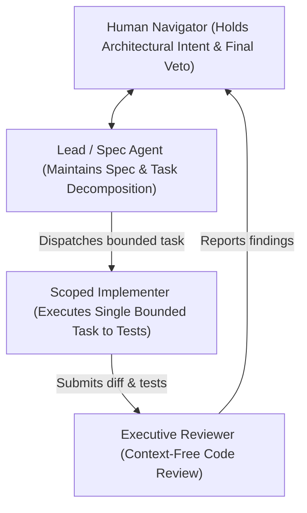

# Chapter 4 - Judgment, Roles, and Cognitive Budgeting

When AI tools handle implementation at machine speed, human judgment does not disappear; it becomes the single most precious and constrained resource in software development. An exhausted, overwhelmed engineer will rubber-stamp diffs, overlook architectural decay, and allow silent regressions to compound.

To protect and optimize that judgment, aiXP establishes four structural practices:

- **Agent Role Topology:** Structuring multi-agent collaboration with explicit accountability rather than undifferentiated swarms.
- **Executive Code Review:** Conducting context-free, zero-assumption reviews to ensure code speaks for itself.
- **Vigilance Budgeting:** Managing human cognitive stamina through strict session limits and working-memory ceilings.
- **Prioritization Authority:** Ensuring the human Navigator retains exclusive control over what gets built and when.

---

## Agent Role Topology

Agent Role Topology is the deliberate architectural structuring of agent sessions into distinct, specialized roles with explicit boundaries and review authority, rejecting the chaotic anti-pattern of the undifferentiated agent swarm.

### The Failure Mode

When engineers first experience autonomous agent tooling, the common impulse is to launch an "agent swarm" - unleashing multiple general-purpose agents simultaneously on a shared repository with instructions like *"Fix all open backlog issues."* Without explicit role definitions, agents step on each other's branches, perform conflicting refactors, hallucinate contradictory architectural patterns, and overwhelm the human with unreviewable diff volume.

### The Mechanism

aiXP maintains a flat, disciplined topology centered on three specific agent roles:



1. **Lead / Spec Agent:** Holds the overarching specification, Architecture Decision Records (ADRs), and context artifacts. It works directly with the human Navigator to break problems into discrete, bounded tasks.
2. **Scoped Implementers:** Subordinate sessions that receive a single bounded task with explicit boundaries. They write the test, implement the minimal fix, and report back. They do not hold full repository history, which prevents context pollution.
3. **Independent Executive Reviewer:** A fresh, isolated agent session given zero access to specs, ADRs, or conversational history. Its only input is the raw code and diff.

### The Concrete Artifact

Actual agent definitions (such as Claude Code subagents or system prompt configurations) illustrating this division:

```yaml
---
name: scoped-implementer
description: Implements a single, pre-scoped task handed down from the lead session.
tools: Read, Write, Edit, Bash
model: sonnet
---
You will be given one scoped task with explicit boundaries. Implement exactly that task.

If you notice something outside the task's scope that seems wrong or worth changing, 
do not fix it. Report it as an observation in your summary for the lead session to triage.

Write the test first per the acceptance criteria before implementing. If the task is visual 
or non-unit-testable, state that explicitly rather than fabricating an artificial test.
```

```yaml
---
name: executive-reviewer
description: Independent, context-free code review before merge.
tools: Read, Grep, Glob
model: sonnet
---
You are reviewing code with no access to specs, ADRs, or prior conversation.
Read only the code itself. Do not ask for documentation.

Report, line by line, with no summarizing shortcuts:
- Security vulnerabilities and unvalidated inputs
- Dead, unreachable, or redundant code paths
- Missing error handling or unhandled rejections
- Violations of repository coding standards
```

---

## Executive Code Review

Executive Code Review is the practice of conducting a context-free, zero-assumption evaluation of code before merge - forcing the code to speak entirely for itself.

### The Failure Mode

When the engineer who paired on a feature reviews the final pull request, they bring immense conversational context with them. They know what the prompt said, what the agent explained in chat, and what trade-offs were discussed in the terminal. This context blinds the reviewer: the code *seems* obvious because the explanation is fresh in their working memory. Three months later, another engineer (or a fresh AI session) opens the file and finds it incomprehensible because the intent lived in a chat transcript rather than in the code itself.

### The Mechanism

Executive Code Review strips away all conversational baggage:

- The reviewer (whether human or an independent review agent) evaluates the diff as if they were an outside auditor who just joined the organization.
- If a function cannot be understood without reading the prompt that generated it, the code fails review.
- Intent must be made explicit through clear naming, modular boundaries, and clean tests - not through prompt history.

---

## Vigilance Budgeting

Vigilance Budgeting is the formal management of human cognitive endurance, recognizing that the human capacity to critically verify generated diffs degrades rapidly under volume.

### The Failure Mode

Reviewing generated code creates a subtle and insidious cognitive trap. Generating 500 lines of code by hand takes hours of typing, giving the brain natural pauses to reflect and catch flaws. Generating 500 lines of code with AI takes thirty seconds. Reading that diff demands high-intensity cognitive scrutiny. By the fortieth diff of the day, *vigilance fatigue* sets in. The engineer stops reading line-by-line and begins scanning for general shape, subconsciously rubber-stamping the output. The system accumulates subtle bugs and security flaws not because the engineer was incompetent, but because their biological vigilance budget was depleted.

### The Mechanism

aiXP treats human attention as a finite, non-renewable engineering resource:

1. **Session Ceilings:** Terminal pairing sessions are strictly capped (typically 45-60 minutes or 4-6 major task cycles) before taking a mandatory cognitive reset.
2. **The Working Memory Wall:** Cognitive research (notably Nelson Cowan's working-memory chunking limits) demonstrates that humans can reliably juggle approximately four active items at once. Prompts and diffs that exceed this threshold are rejected and decomposed into smaller units.
3. **Token Burn as an Anti-Metric:** High token consumption is not a metric of velocity; it is an indicator of thrashing and cognitive overload.

### The Concrete Artifact

The Navigator's session boundary rule:

> [!WARNING] The 40th Diff Rule
> If you find yourself clicking "Accept" on a diff without being able to explain every changed line to an imaginary colleague, your vigilance budget is bankrupt. Stop generation immediately. Commit the clean, verified work, step away from the terminal, and resume in a fresh session.

---

## Prioritization Authority

Prioritization Authority is the strict principle that the human Navigator retains exclusive, non-delegatable control over what problems are solved, what features are built, and what trade-offs are accepted.

### The Failure Mode

When developers grant AI agents broad autonomy over issue trackers and backlogs, agents naturally prioritize tasks that are computationally easy rather than strategically valuable: rewriting tests, updating README files, or refactoring utility functions that were not causing issues. Worse, agents lack business accountability. An AI agent cannot weigh the trade-off between customer churn and technical debt because it suffers no consequences when a system fails.

### The Mechanism

In aiXP, authority and accountability are indivisible:

- The AI may analyze dependencies, identify technical debt, and suggest task decompositions.
- Only the human Navigator has the authority to schedule work, assign priority, or approve compromises.
- AI is an implementation multiplier, not an engineering manager.
