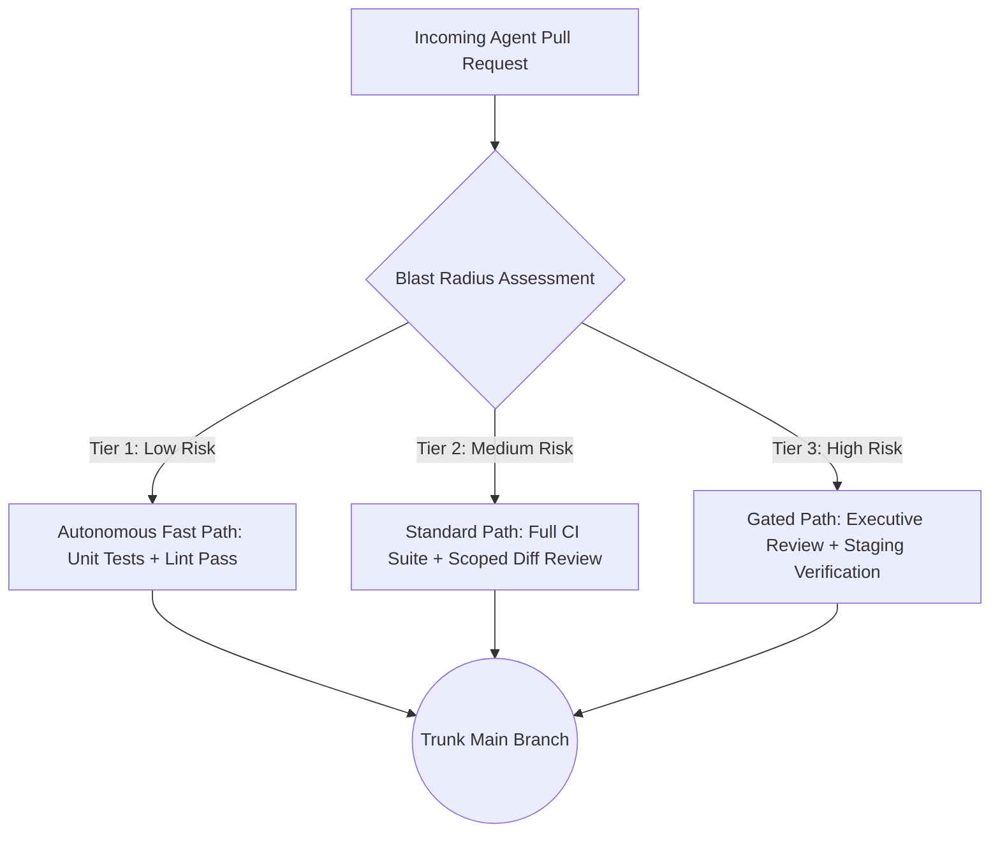

# Chapter 5 - Verification Strategy and Integration

In traditional software development, testing was often viewed as a quality tax - an activity that slowed down feature delivery in exchange for safety. In aiXP, that relationship inverts. When code generation costs approach zero, verification is not a tax; it *is* the throughput of your development pipeline.

This chapter details the four core practices that transform testing and continuous integration into an automated, machine-speed verification engine:

- **The Verification Bottleneck:** Applying the Theory of Constraints to AI development velocity.
- **The Four Testing Tiers:** Structuring a multi-tiered safety net from unit tests to contract boundaries.
- **Continuous Integration and Risk-Tiered Merge Authority:** Decoupling merge velocity from human review bottlenecks.
- **Regression Suite Maintenance at Machine Speed:** Using AI to eliminate the historical atrophy of regression testing.

---

## The Verification Bottleneck

The central economic thesis of aiXP is grounded in Eliyahu Goldratt's *Theory of Constraints*: a system's throughput is determined exclusively by its most constrained resource. Optimizing any non-bottleneck resource is an illusion.

### The Failure Mode

When an engineering team adopts AI coding tools, their initial reaction is to celebrate how quickly code is typed. They generate dozens of files, scaffold entire subsystems in minutes, and submit massive pull requests. But soon, velocity grinds to a halt. Pull request queues become hopelessly clogged, manual QA teams are overwhelmed, and regressions skyrocket. The team optimized code generation - which was never the bottleneck - and flooded the actual bottleneck: the human capacity to verify correctness.

### The Mechanism

In aiXP, the bottleneck is recognized as verification and judgment:

- **Tests are Throughput:** A comprehensive, fast-running automated test suite is the only mechanism that allows an engineer to safely merge high volumes of generated code.
- **Zero-Trust Generation:** All AI-generated output is treated as unverified candidate code until mechanical test harnesses prove it satisfies acceptance criteria.
- **Fast Feedback Loops:** Tests must run in seconds, giving the human Navigator immediate, deterministic feedback before diffs are accepted into trunk.

---

## The Four Testing Tiers

Historically, maintaining a multi-tiered testing ladder required enterprise-scale QA headcount that small teams and solo practitioners could not afford. AI tooling dramatically flattens this cost curve, making a complete, disciplined testing ladder viable at any scale.

### The Ladder Architecture

1. **Unit Tests:** The smallest possible scope, testing isolated functions and pure logic. As detailed in Chapter 3, unit tests are written *before* implementation via Test-Driven Development (TDD) to drive AI generation.
2. **Integration Tests:** Verify that disparate units interact correctly across module boundaries (e.g. verifying that a service properly queries the database layer or that an API controller returns the expected JSON envelope).
3. **Contract and Schema Tests:** Explicitly validate data payloads against defined schemas (e.g. OpenAPI, GraphQL, or Protobuf contracts). AI models excel at generating plausible code that subtly violates field names or nullable types; contract tests prevent these silent mismatches.
4. **End-to-End (E2E) and Perception-Gated Verification:** Validate user journeys across the full running stack. For visual or tactile interfaces where unit automation is impossible, verification shifts to human perception-gated passes and staged internal dogfooding.

---

## Continuous Integration and Risk-Tiered Merge Authority

Continuous Integration (CI) in aiXP is not merely an automated build script; it is a risk-tiered authority framework that matches verification rigor directly to the blast radius of the change.

### The Failure Mode

If every single change requires an exhaustive, multi-step manual verification pass by the human Navigator, the human becomes a choking bottleneck. Conversely, if all agent-generated pull requests are merged automatically based on shallow test passes, subtle regressions slip into trunk unchecked.

### The Mechanism

aiXP adopts **Trunk-Based Development** paired with an explicit, three-tier merge authority model:

- **Tier 1 (Low Risk / Internal):** Pure documentation updates, typo fixes, or isolated internal unit refactors with 100% test coverage. Fast-pathed through CI with lightweight spot review.
- **Tier 2 (Medium Risk / Functional):** Additive feature logic, new internal service endpoints, or dependency upgrades. Requires a full green CI run (unit + integration + contract) and a focused Navigator diff inspection.
- **Tier 3 (High Risk / Architectural):** Database schema migrations, authentication logic, payment processing, or public API contract mutations. Demands full CI, an independent Executive Code Review pass, and manual verification on an isolated preview environment before merge.

---

## Regression Suite Maintenance at Machine Speed

Regression testing is the systematic practice of capturing every discovered bug as an automated test case to ensure it can never recur.

### The Failure Mode

In classic software engineering, regression suites suffered from chronic atrophy. Writing a regression test *after* diagnosing and fixing a bug was tedious, unrewarded overhead. Developers under deadline pressure would patch the bug, verify it manually once in the browser, and move to the next feature. Over time, previously fixed defects quietly returned, eroding confidence in the codebase.

### The Mechanism

AI pairing completely eliminates the friction of regression testing:

- **Zero-Cost Test Generation:** When a production bug is identified, the Navigator prompts the AI to write a failing reproduction test *before* applying the fix.
- **Permanent Hardening:** Once the fix is applied and verified, the reproduction test permanently joins the automated regression suite.
- **Eliminating Hallucinated Tests:** The Navigator must explicitly verify that the regression test fails against the unpatched code. A test that passes before the fix is applied is a hallucinated assertion that provides false confidence.
