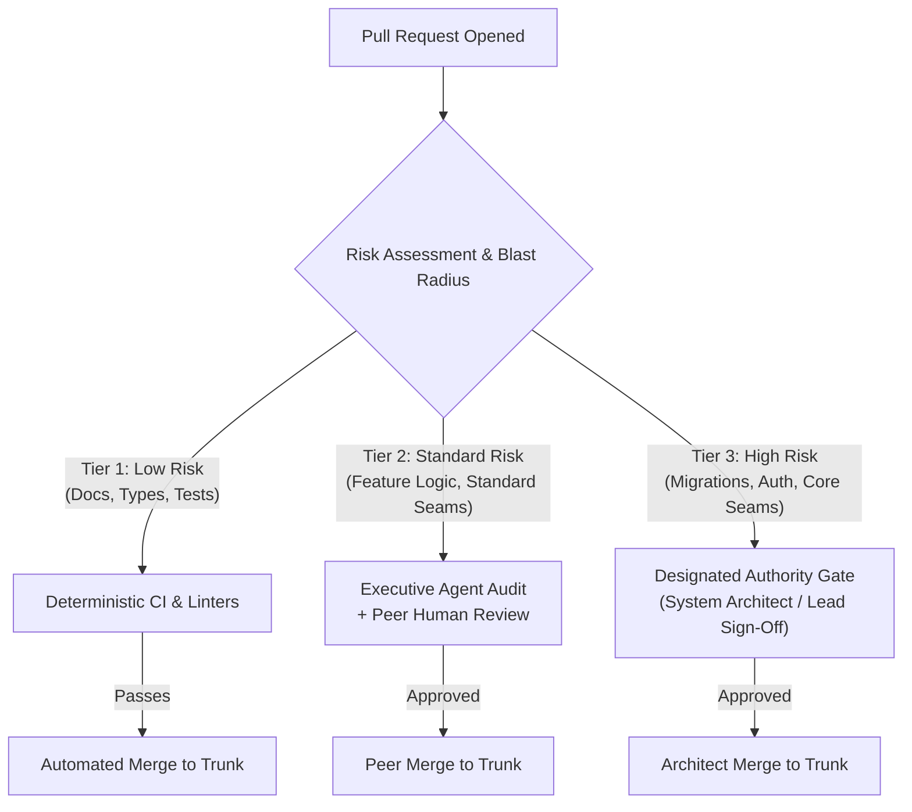
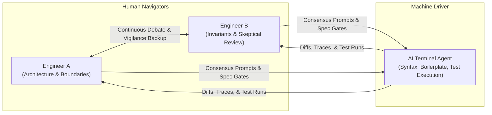

# Chapter 8 - Scaling Beyond the Solo Practitioner

The empirical findings documented across Part I and Part II - the four-session cognitive ceiling, the vigilance degradation curve, and single-practitioner merge authority - were calibrated on an engineer operating solo at the terminal. That is not a limitation of the discipline; it is an honest account of the operating boundary where it was developed and tested.

This chapter addresses what happens when the boundary expands: when multiple engineers, each running their own asymmetric pairing loops, work across a shared codebase, a shared repository, and a shared team culture.

Some practices remain anchored at the individual desk. Others become shared infrastructure that must be explicitly governed. And several standard team practices - chief among them velocity estimation, branch integration, and engineer onboarding - break under machine-speed generation unless fundamentally re-anchored.

---

## What Stays at the Desk

The core technical practices of aiXP are engineering disciplines, not coordination protocols. They operate inside the feedback loop of a single practitioner and do not require organization-wide consensus to deliver leverage:

- **Spec-First Prompting:** Grounding generation in concrete boundaries before producing code is an individual cognitive discipline.
- **Test-Driven Development (TDD):** The red-green-refactor loop remains the fastest mechanism for an individual engineer to verify implementation correctness at the machine boundary.
- **Executive Code Review as a Personal Habit:** Running an isolated, read-only agent to audit diffs before human review protects individual stamina regardless of team size. While the team may mandate review transcripts as a pull request artifact, the practice itself originates as a personal defense against vigilance fatigue.
- **Perception-Gated Work:** Halting execution at physical, sensory, or air-gapped seams prevents wasted synthetic mocking whether working solo or on a team of fifty.

Extreme Programming's history is instructive here. Practices like TDD and continuous refactoring spread across the software industry not because entire organizations converted to XP, but because individual engineers adopted them at their own desks to survive complex systems. In an asymmetric pairing environment, these desk-level habits form the primary immune system of the individual contributor.

---

## What Becomes Shared Infrastructure

When multiple practitioners operate concurrently, personal configurations and informal habits must transition into shared, versioned engineering infrastructure.

### Shared Context Stewardship and the Three-Tier Architecture

At an individual desk, maintaining `CLAUDE.md` or repository memory is an intuitive habit. If context drifts, the engineer who caused the drift experiences immediate friction in their next session and repairs it.

Across a team, context files become shared production assets. Without explicit governance, shared context degrades into one of two failure modes:
1. **The Tragedy of the Context Commons:** No individual feels responsible for pruning stale instructions. Superseded rules accumulate into an append-only museum, diluting model attention across the entire team.
2. **Context Thrashing:** Engineer A tunes root instructions for a frontend subsystem, while Engineer B overwrites them to optimize backend generation, breaking prompt stability across active sessions.

Furthermore, a real-world team faces three competing context requirements:
- **Program Leads and Architects** require repository-wide invariants, build and test commands, and quality gates that no engineer's agent can ignore.
- **Subsystem Feature Leads** require domain-specific laws (such as mobile state machine rules or backend cryptographic constraints) that apply only within their boundary.
- **Individual Engineers** operate in unique local workstations with personal shell configurations (Windows PowerShell vs. macOS zsh), local ports, private keys, or scratch paths that must never pollute Git or clobber a teammate's environment.

To reconcile these needs, teams structure repository memory into a **Three-Tier Context Architecture**:

```text
my-project/
├── .github/
│   └── workflows/
│       └── context-linter.yml     # Automated CI check: token ceilings & forbidden patterns
├── .gitignore                     # Ignores *.local.md and personal scratch configurations
├── CLAUDE.md                      # Layer 1: Global Law (Tooling, root invariants, PR standards)
├── CLAUDE.local.md                # Layer 3: Personal Overrides (Local OS, shell, private ports)
├── apps/
│   └── mobile/
│       ├── CONTEXT.md             # Layer 2: Subsystem Law (Flutter state, UI widget invariants)
│       └── ...
└── services/
    └── auth/
        ├── CONTEXT.md             # Layer 2: Subsystem Law (Token lifetimes, cryptographic seams)
        └── ...
```

#### Layer 1: Global Repository Law (Program Leadership)
- **Location:** Root `/CLAUDE.md` (or tool equivalent like `/GEMINI.md`).
- **Scope:** Universal build, test, and lint commands, monorepo navigation rules, and core architectural invariants.
- **Governance:** Managed in Git. Modifications alter prompt behavior for every engineer on the team and require Tier 3 Architect review.

#### Layer 2: Subsystem Domain Invariants (Feature Leads)
- **Location:** Subdirectory context files (such as `/apps/mobile/CONTEXT.md` or scoped `CLAUDE.md` files).
- **Scope:** Seam-specific data contracts, architectural patterns, local test harnesses, and domain negative constraints.
- **Discovery Mechanism:** Because tool harnesses do not automatically scan arbitrary files named `CONTEXT.md` by default, discovery is anchored through the root `CLAUDE.md`. The root file contains an explicit dispatch rule:
  > *"When working within a subdirectory, inspect and read the local `CONTEXT.md` before executing tasks. Subsystem rules specialize and extend root guidelines."*
  Alternatively, teams using CLI tools that support directory nesting name these files `apps/mobile/CLAUDE.md`, allowing the tool to inherit them automatically when launched within that working directory.
- **Governance:** Maintained by feature leads through *Same-Commit Stewardship*. If a PR modifies a subsystem interface, the corresponding `CONTEXT.md` must be updated in the same diff.

#### Layer 3: Workstation Overrides (Individual Engineer)
- **Location:** `/CLAUDE.local.md` (or `.claude/personal.md`).
- **Scope:** Personal developer environment quirks (e.g., *"Running on Windows 11 under PowerShell; use `python` instead of `python3`"*), custom port mappings, local database credentials, and personal scratch paths.
- **Discovery and Safety:** Supported natively by modern agent harnesses (like Claude Code CLI, which ingests `CLAUDE.local.md` automatically on top of `CLAUDE.md`).
- **Governance:** Strictly added to `.gitignore`. Local overrides must never be committed to repository history, ensuring personal environment fixes cannot break CI or alter other engineers' pairing loops.

#### Collation Precedence and CI Oversight
When an agent session initializes, context collates according to strict precedence:

```
[ Layer 1: Global Root Law ]  --> Base constraints & commands (Mandatory)
            +
[ Layer 2: Subsystem Law ]    --> Specializes domain invariants (Additive)
            +
[ Layer 3: Local Overrides ]  --> Workstation execution hints (Local Only)
```

Precedence is additive, but invariant-locked: a Layer 3 local override can define *how* a test runner is executed locally, but it cannot override an architectural invariant or verification gate established in Layer 1 or Layer 2.

To prevent context drift, teams automate oversight with a **CI Context Linter**:
- Validates that root and subsystem context files do not exceed defined token ceilings (preventing context window bloat).
- Scans for banned historical anti-patterns, such as append-only changelogs ("As of March 2026...").
- Fails the build if `.local.md` files or personal environment configurations are accidentally tracked in Git.

### Team Agent Role Topology

At an individual desk, assigning an agent to act as a Lead Dev, Spec Author, or Reviewer is a session-level judgment call. Across a team, uncoordinated agents operating with unspecified authorities create chaos: an implementation agent dispatched by one engineer may review and merge code written by an agent dispatched by another.

Teams require an explicit matrix governing what autonomous sessions are authorized to execute:

| Role Assignment | Context Scope | Mutation Authority | Human Oversight Gate |
| :--- | :--- | :--- | :--- |
| **Spec / Lead Agent** | Repository-wide specs, ADRs, issue backlog | Read-only across code; writes to `/specs` | Human Navigator must approve spec before dispatching tasks |
| **Worker / Dev Agent** | Bounded subsystem, active branch | Full edit rights within assigned module seam | Confined to branch; cannot touch shared foundational interfaces |
| **Executive Review Agent** | Clean git diff, target branch context | Strictly read-only; no filesystem mutation | Generates findings for human reviewer; zero commit authority |
| **Release / CI Agent** | Release manifests, changelogs, build artifacts | Staging and release metadata branches | Triggered only after human approval gate passes |

Codifying these boundaries prevents concurrent agent sessions from contradicting each other or bypassing verification layers.

---

## What Breaks at Scale

Scaling asymmetric pairing does not simply increase output linearly. It introduces non-linear stress on coordination mechanisms designed for human-speed oversight.

### Velocity Estimation and Story Points

Traditional agile frameworks rely on story points and sprint velocity under the assumption of roughly uniform throughput. Estimating a task at "five points" assumes a historical baseline of how long a human engineer takes to write, test, and debug that volume of logic.

In an asymmetric pairing environment, that baseline evaporates:

- An engineer with maintained context, stable testing harnesses, and well-bounded seams can complete a complex refactoring in forty-five minutes.
- That same engineer, working in an unmapped subsystem with high domain ambiguity and noisy context, may spend three days fighting prompt thrashing and synthetic test deception.
- Two engineers with identical experience levels will exhibit massive throughput variance depending on the quality of their spec prompts and their vigilance budgeting discipline.

Story points become meaningless noise. When typing syntax is no longer the bottleneck, measuring effort by time or points obscures actual operational risk.

Teams must shift estimation toward **Complexity and Blast Radius Gating**:

| Complexity Tier | Seam Stability | Verification Mechanism | Context Freshness | Operational Protocol |
| :--- | :--- | :--- | :--- | :--- |
| **Tier A (Mechanical / High Certainty)** | Bounded within single isolated module | Fast deterministic CI (100% synthetic) | Up-to-date subsystem `CONTEXT.md` | Single-session execution; standard peer review |
| **Tier B (Interface / Cross-Boundary)** | Touches shared models, APIs, or cross-cutting utilities | Integration suites + consumer contracts | Requires minor spec updates upfront | Dual-Navigator spec review prior to agent dispatch |
| **Tier C (High Ambiguity / Physical)** | Unmapped legacy code or external hardware | Human sensory / live viewport / tactile glass | High domain gap; stale or missing docs | Spike session first; Domain Gap Surfacing; physical gate |

### The Pull Request Bottleneck and Merge Authority

In a solo workflow, a single engineer serves as the sole Merge and Integration Authority. Reviewing every diff and maintaining trunk integrity is straightforward because diff volume is constrained by one person's working hours.

When five or ten engineers operate with AI drivers, code generation accelerates dramatically. If every agent generates three large pull requests a day, the team faces a relentless stream of multi-hundred-line diffs. Under this volume, human vigilance collapses, leading directly to rubber-stamp approvals and trunk destabilization.

Teams resolve this bottleneck through **Risk-Tiered Merge Authority**:



- **Tier 1 (Automated Merge):** Strictly bounded documentation, static typing adjustments, or localized test additions. If deterministic CI suites and linter gates pass, automated merge is permitted without human review contention.
- **Tier 2 (Peer Review + Agent Audit):** Standard feature additions within established seams. Requires an attached Executive Review Agent audit transcript followed by sign-off from a peer human engineer.
- **Tier 3 (Designated Authority):** Cross-cutting architectural changes, core data migrations, security boundaries, and shared foundation refactors. These changes require review and sign-off by a designated system architect or subsystem lead.

### Trunk Contention and Branch Lifespans

When multiple engineers pair with AI drivers, code generation velocity multiplies across the team. In this environment, traditional Git workflows break down:

- **Branch Rot at Machine Speed:** Feature branches that live longer than twenty-four hours quickly fall behind trunk. Because agents generate large, syntactically clean diffs, rebasing an aging branch against a fast-moving trunk introduces complex semantic merge conflicts that consume hours of human cognitive energy to unwind.
- **Continuous Integration at Sub-Day Cadence:** Teams must practice strict trunk-based development. Features are sliced into small, verified increments that merge to trunk multiple times a day.
- **Decoupling Deployment from Release:** To merge incomplete features without destabilizing production, teams rely on compile-time boundary checks, dark launches, and runtime feature flags. Slicing work into sub-day trunk merges prevents parallel agents from clobbering each other's abstractions.

---

## Human-to-Human Pairing as an Ongoing Superpower

When every developer at a workstation has access to a tireless AI pair, does human-to-human pair programming become obsolete?

In the early wave of generative AI adoption, many teams assumed the answer was yes: if the model writes the boilerplate, tests, and syntax, pairing two human engineers at one screen feels like a 50% productivity tax. That conclusion misunderstands both classic Extreme Programming and the failure modes of AI-assisted generation.

In classic XP, pair programming was never merely a training tool or a tactical syntax check. It was a continuous, team-wide engineering superpower. Two engineers sharing a terminal produced higher design coherence, eliminated knowledge silos, and provided continuous, real-time code review. Crucially, the dynamic was always bi-directional: regardless of seniority, both engineers constantly learned from each other - discovering alternative debugging heuristics, exploring new libraries, and catching blind spots that neither would have identified in isolation.

At machine speed, human-to-human pairing does not fade away. It transforms into an even higher-leverage discipline: **The Triad Dynamic**.

### The Triad Dynamic: Two Humans, One Machine Driver

When two engineers sit together before an AI driver, they form an asymmetric triad. The machine driver absorbs the tactical, mechanical labor of typing syntax, executing commands, and running test loops. This frees both human engineers to operate purely as strategic Navigators.



The triad dynamic delivers advantages that neither a solo AI practitioner nor traditional human pairing can achieve alone:

1. **Continuous Vigilance Insurance:** The primary failure mode of solo asymmetric pairing is cognitive fatigue. An engineer operating alone for hours experiences vigilance collapse; their working memory saturates, and they begin to accept reassuring explanations and skim multi-file diffs. In a human pair, vigilance budgets reinforce each other. When one engineer's focus wavers, the other catches the silent tool buffer truncation, the fabricated mock, or the missing boundary check.
2. **Pre-Prompt Architectural Consensus:** In a solo loop, bad architecture often begins with an underspecified prompt that improvises data structures. In a human pair, engineers debate the specification, invariants, and negative constraints *before* issuing the prompt. The model is never dispatched against ambiguous intent.
3. **Collective Ownership at Machine Velocity:** If an engineer works solo with an AI generating 3,000 lines of code a week, that codebase rapidly turns into an unreadable personal silo. Nobody else understands the nuances of why the agent structured the abstractions that way. Pairing ensures that at least two human minds possess deep mental models of every newly generated subsystem, preserving true collective code ownership across the organization.

### Accelerated Apprenticeship: The Manager's Leverage

For engineering leaders, the triad model completely redefines team onboarding and junior apprenticeship.

The acute challenge facing engineering managers in the AI era is the **junior developer dilemma**: if autonomous agents generate all the boilerplate that junior engineers historically wrote to learn the craft, how do apprentices develop foundational engineering judgment? Handing an autonomous agent to an unanchored junior engineer on day one guarantees vibe coding - they accept diffs they cannot evaluate and approve code they cannot maintain.

Software engineering has wrestled with this vulnerability across every technological shift: pasting snippets from Stack Overflow, importing opaque packages, relying on leaky framework abstractions, and trusting IDE autocompletions. Generative AI does not create a new failure mode; it magnifies an existing human trap by orders of magnitude.

When an apprentice is embedded in an active, ongoing pairing culture, their ramp-up is supercharged:

- **Tactile Foundations First:** Incoming engineers initially spend time on manual tasks within well-mapped seams: fixing localized bugs, reading execution traces, and writing unit tests by hand. This establishes tactile familiarity with the build pipelines, compiler error messages, and system invariants before introducing generative tooling.
- **Classic XP Pairing as the Pedagogical Bridge:** Before driving an AI, the apprentice pairs directly with experienced engineers in classic XP style: passing the keyboard back and forth, alternating between dictating strategy and typing implementation. The apprentice observes how seasoned engineers think, navigate ambiguity, and trace runtime failures.
- **The Senior-Junior Triad Rotation:** When the pair brings in the AI driver, the apprentice takes the keyboard as the active Navigator formulating prompts, while the senior engineer sits alongside as the Advisory Navigator. The apprentice must articulate their prompt boundaries and evaluate incoming diffs aloud. The senior mentor intercedes not to dictate code, but to challenge oversight: *"Why did the agent choose that data structure? What happens if that socket drops? Does that test assert real behavior, or does it merely mirror the mock?"*
- **Bi-Directional Learning in Practice:** The learning is not a one-way street. Junior engineers bring fresh curiosity, question legacy assumptions, and explore modern frameworks unburdened by institutional inertia. Senior engineers frequently pick up new terminal workflows, prompt formulations, and tooling tricks from their junior partners.
- **Active Curiosity as the Core Skill:** Newer engineers learn that curiosity is their primary career lever. Rather than passively accepting clean syntax, they use the AI as an interactive tutor - interrogating the agent on design trade-offs (*"Why this pattern over alternatives?"*), validating their comprehension under the Feynman rule (*explain the system without the tool*), and running manual red-green test drills to cement deterministic verification into their daily practice.

For an engineering organization, pair programming in an aiXP environment is not a luxury or a remedial onboarding band-aid. It is an investment that pays immediate dividends: it halves review contention, eliminates knowledge silos, prevents systemic technical debt, and manufactures senior engineering judgment in a fraction of the traditional timeline.

---

## The aiXP-to-Organization Interface

An engineering team practicing aiXP rarely exists in an organizational vacuum. The surrounding enterprise typically operates on standardized frameworks like Scrum, Kanban, or SAFe.

aiXP does not require restructuring the enterprise. Like classic Extreme Programming, it operates cleanly as an internal engine within existing organizational interfaces:

- **The Committed Artifact as the Handoff Boundary:** The interface between an aiXP engineering team and the broader organization is the committed artifact: a formal Product Requirement Document, an Architecture Decision Record (ADR), a verified pull request, or a working deployment. 
- **Decoupled Planning Cadence:** Product management can continue planning in sprints or quarters. The engineering team translates user stories into spec constellations and bounded tasks internally, using asymmetric pairing to deliver increments without altering external reporting structures.
- **Transparent Operational Traceability:** Because aiXP mandates structured commit histories, explicit spec trees, and documented review trails, the team provides superior compliance, auditability, and observability to the organization.

By keeping the discipline focused at the code and verification boundary, a team preserves engineering rigor without forcing ideological conversions on the rest of the company.
