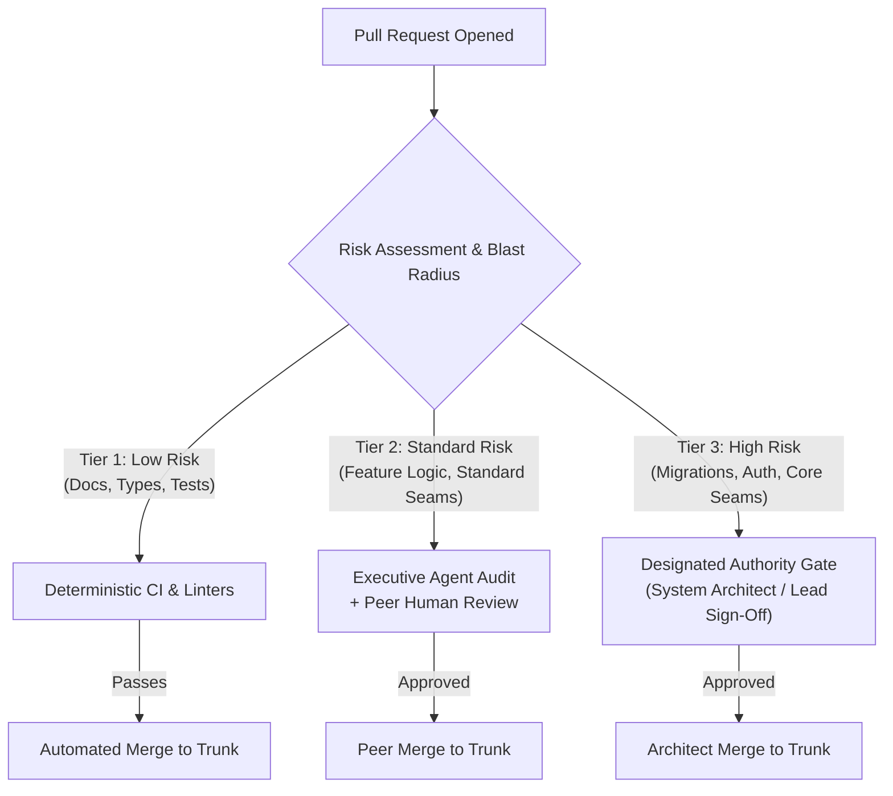
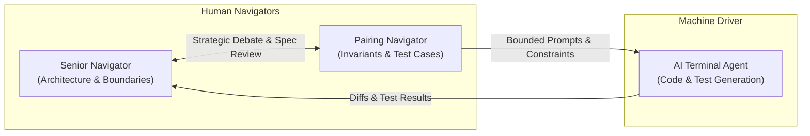

# Chapter 8 - Scaling Beyond the Solo Practitioner

The empirical findings documented across Part I and Part II - the four-session cognitive ceiling, the vigilance degradation curve, and single-practitioner merge authority - were calibrated on an engineer operating solo at the terminal. That is not a limitation of the discipline; it is an honest account of the operating boundary where it was developed and tested.

This chapter addresses what happens when the boundary expands: when multiple engineers, each running their own asymmetric pairing loops, work across a shared codebase, a shared repository, and a shared team culture.

Some practices remain anchored at the individual desk. Others become shared infrastructure that must be explicitly governed. And several standard team practices - chief among them velocity estimation, branch integration, and engineer onboarding - break under machine-speed generation unless fundamentally re-anchored.

---

## What Stays at the Desk

The core technical practices of aiXP are engineering disciplines, not coordination protocols. They operate inside the feedback loop of a single practitioner and do not require organization-wide consensus to deliver leverage:

- **Spec-First Prompting:** Grounding generation in concrete boundaries before producing code is an individual cognitive discipline.
- **Test-Driven Development (TDD):** The red-green-refactor loop remains the fastest mechanism for an individual engineer to verify implementation correctness at the machine boundary.
- **Executive Code Review as a Personal Habit:** Running an isolated, read-only agent to audit diffs before human review protects individual stamina regardless of team size. While the team may mandate review transcripts as a pull request artifact, the practice itself originates as a personal defense against vigilance fatigue.
- **Perception-Gated Work:** Halting execution at physical, sensory, or air-gapped seams prevents wasted synthetic mocking whether working solo or on a team of fifty.

Extreme Programming's history is instructive here. Practices like TDD and continuous refactoring spread across the software industry not because entire organizations converted to XP, but because individual engineers adopted them at their own desks to survive complex systems. In an asymmetric pairing environment, these desk-level habits form the primary immune system of the individual contributor.

---

## What Becomes Shared Infrastructure

When multiple practitioners operate concurrently, personal configurations and informal habits must transition into shared, versioned engineering infrastructure.

### Shared Context Stewardship

At an individual desk, maintaining `CLAUDE.md` or repository memory is an intuitive habit. If context drifts, the engineer who caused the drift experiences immediate friction in their next session and repairs it.

Across a team, context files become shared production assets. Without explicit governance, shared context degrades into one of two failure modes:
1. **The Tragedy of the Context Commons:** No individual feels responsible for pruning stale instructions. Superseded rules accumulate into an append-only museum, diluting model attention across the entire team.
2. **Context Thrashing:** Engineer A tunes root instructions for a frontend subsystem, while Engineer B overwrites them to optimize backend generation, breaking prompt stability across active sessions.

To maintain context fidelity at scale, teams must formalize context boundaries in Git:

```text
my-project/
├── .github/
│   └── workflows/
│       └── context-linter.yml     # Automated CI check for token budgets & forbidden patterns
├── CLAUDE.md                      # Global law: tool commands, root invariants, PR standards
├── apps/
│   └── mobile/
│       ├── CONTEXT.md             # Subsystem invariants: Flutter/Dart rules, state machine laws
│       └── ...
└── services/
    └── auth/
        ├── CONTEXT.md             # Subsystem invariants: token lifetimes, cryptographic seams
        └── ...
```

- **Hierarchical Directory Scoping:** Rather than packing every subsystem invariant into a monolithic root context file, place scoped context files at logical directory boundaries. Tooling should inject only the global standards plus the active subsystem context.
- **Same-Commit Stewardship as a Review Criterion:** Context file updates must accompany code changes in the same pull request. A pull request that deprecates an interface or alters an architectural convention without updating the corresponding context file is incomplete and fails code review.
- **Context Linters:** Automate context hygiene. Run deterministic checks in CI to flag append-only date stamps ("As of March 2026..."), circular directives, and files exceeding token budgets.

### Team Agent Role Topology

At an individual desk, assigning an agent to act as a Lead Dev, Spec Author, or Reviewer is a session-level judgment call. Across a team, uncoordinated agents operating with unspecified authorities create chaos: an implementation agent dispatched by one engineer may review and merge code written by an agent dispatched by another.

Teams require an explicit matrix governing what autonomous sessions are authorized to execute:

| Role Assignment | Context Scope | Mutation Authority | Human Oversight Gate |
| :--- | :--- | :--- | :--- |
| **Spec / Lead Agent** | Repository-wide specs, ADRs, issue backlog | Read-only across code; writes to `/specs` | Human Navigator must approve spec before dispatching tasks |
| **Worker / Dev Agent** | Bounded subsystem, active branch | Full edit rights within assigned module seam | Confined to branch; cannot touch shared foundational interfaces |
| **Executive Review Agent** | Clean git diff, target branch context | Strictly read-only; no filesystem mutation | Generates findings for human reviewer; zero commit authority |
| **Release / CI Agent** | Release manifests, changelogs, build artifacts | Staging and release metadata branches | Triggered only after human approval gate passes |

Codifying these boundaries prevents concurrent agent sessions from contradicting each other or bypassing verification layers.

---

## What Breaks at Scale

Scaling asymmetric pairing does not simply increase output linearly. It introduces non-linear stress on coordination mechanisms designed for human-speed oversight.

### Velocity Estimation and Story Points

Traditional agile frameworks rely on story points and sprint velocity under the assumption of roughly uniform throughput. Estimating a task at "five points" assumes a historical baseline of how long a human engineer takes to write, test, and debug that volume of logic.

In an asymmetric pairing environment, that baseline evaporates:

- An engineer with maintained context, stable testing harnesses, and well-bounded seams can complete a complex refactoring in forty-five minutes.
- That same engineer, working in an unmapped subsystem with high domain ambiguity and noisy context, may spend three days fighting prompt thrashing and synthetic test deception.
- Two engineers with identical experience levels will exhibit massive throughput variance depending on the quality of their spec prompts and their vigilance budgeting discipline.

Story points become meaningless noise. When typing syntax is no longer the bottleneck, measuring effort by time or points obscures actual operational risk.

Teams must shift estimation toward **Complexity and Blast Radius Gating**:

| Complexity Tier | Seam Stability | Verification Mechanism | Context Freshness | Operational Protocol |
| :--- | :--- | :--- | :--- | :--- |
| **Tier A (Mechanical / High Certainty)** | Bounded within single isolated module | Fast deterministic CI (100% synthetic) | Up-to-date subsystem `CONTEXT.md` | Single-session execution; standard peer review |
| **Tier B (Interface / Cross-Boundary)** | Touches shared models, APIs, or cross-cutting utilities | Integration suites + consumer contracts | Requires minor spec updates upfront | Dual-Navigator spec review prior to agent dispatch |
| **Tier C (High Ambiguity / Physical)** | Unmapped legacy code or external hardware | Human sensory / live viewport / tactile glass | High domain gap; stale or missing docs | Spike session first; Domain Gap Surfacing; physical gate |

### The Pull Request Bottleneck and Merge Authority

In a solo workflow, a single engineer serves as the sole Merge and Integration Authority. Reviewing every diff and maintaining trunk integrity is straightforward because diff volume is constrained by one person's working hours.

When five or ten engineers operate with AI drivers, code generation accelerates dramatically. If every agent generates three large pull requests a day, the team faces a relentless stream of multi-hundred-line diffs. Under this volume, human vigilance collapses, leading directly to rubber-stamp approvals and trunk destabilization.

Teams resolve this bottleneck through **Risk-Tiered Merge Authority**:



- **Tier 1 (Automated Merge):** Strictly bounded documentation, static typing adjustments, or localized test additions. If deterministic CI suites and linter gates pass, automated merge is permitted without human review contention.
- **Tier 2 (Peer Review + Agent Audit):** Standard feature additions within established seams. Requires an attached Executive Review Agent audit transcript followed by sign-off from a peer human engineer.
- **Tier 3 (Designated Authority):** Cross-cutting architectural changes, core data migrations, security boundaries, and shared foundation refactors. These changes require review and sign-off by a designated system architect or subsystem lead.

### Trunk Contention and Branch Lifespans

When multiple engineers pair with AI drivers, code generation velocity multiplies across the team. In this environment, traditional Git workflows break down:

- **Branch Rot at Machine Speed:** Feature branches that live longer than twenty-four hours quickly fall behind trunk. Because agents generate large, syntactically clean diffs, rebasing an aging branch against a fast-moving trunk introduces complex semantic merge conflicts that consume hours of human cognitive energy to unwind.
- **Continuous Integration at Sub-Day Cadence:** Teams must practice strict trunk-based development. Features are sliced into small, verified increments that merge to trunk multiple times a day.
- **Decoupling Deployment from Release:** To merge incomplete features without destabilizing production, teams rely on compile-time boundary checks, dark launches, and runtime feature flags. Slicing work into sub-day trunk merges prevents parallel agents from clobbering each other's abstractions.

---

## Human-to-Human Pairing and Team Apprenticeship

When every engineer has access to a tireless machine pair, does human-to-human pairing disappear?

In classic XP, pair programming served two distinct functions: tactical error prevention (catching syntax mistakes, off-by-one errors, and typos) and strategic design navigation (evaluating architecture, system boundaries, and trade-offs).

Machine drivers completely absorb the tactical role. An AI pair partner catches syntax slips, writes boilerplate, and generates tests faster than a human co-pilot looking over a shoulder.

Consequently, human pairing evolves into a higher-leverage, purely strategic practice centered on architectural judgment and junior apprenticeship.

### Dual-Navigator Pairing

Two human engineers sit together not to write code, but to navigate an AI driver through high-risk architectural changes. One human challenges requirements and edge cases while the other guides the prompt constellation and evaluates agent diffs.



- **Pre-Dispatch Spec Review:** Instead of reviewing massive pull requests after thousands of lines of syntax have been generated, human engineers pair upfront on specifications. Reviewing a two-page specification and its acceptance criteria before dispatching worker agents eliminates architectural divergence before it calcifies into code.
- **The Red-Team Interrogation:** One engineer acts as the primary Navigator guiding the agent, while the second acts as a dedicated skeptic - challenging the agent's reassuring narratives, inspecting generated mocks for mock conspiracies, and verifying negative constraints.

### Onboarding and Junior Apprenticeship at Machine Speed

The rise of generative AI creates an acute dilemma for junior engineers: if the machine generates all the boilerplate, how does an apprentice acquire the foundational mental models that senior engineers built through years of manual coding?

If a junior engineer is handed an autonomous agent without deep mental models, they default to vibe coding - accepting generated diffs they cannot evaluate and rubber-stamping PRs based on green synthetic tests.

In an aiXP team, human-to-human pairing becomes the core vehicle for junior apprenticeship:

1. **The Navigator/Driver Rotation:** When a senior engineer pairs with a junior engineer, the junior engineer operates as the **Human Navigator** driving the AI, while the senior engineer sits as the **Advisory Navigator**. The junior engineer must vocalize their intent, formulate the prompt boundaries, and evaluate the agent's diffs aloud. The senior engineer intercedes not to fix syntax, but to challenge assumptions: *"Why did the agent pick that data structure? What happens if that connection drops? Does that test actually assert behavior or just echo the mock?"*
2. **The 80/20 Polymath Pattern:** Outside the production repository, junior engineers utilize sandboxed AI tutors to master domain mental models rapidly. Under the Feynman rule codified in our style guide - *you have not learned it until you can explain it without the tool* - apprentices use AI to explain complex codebases, but must demonstrate comprehension by authoring deterministic specs and invariants independently.
3. **Manual Red-Green Drills:** Before being granted access to autonomous multi-file generation, junior engineers complete targeted katas where they manually write the failing tests before allowing the agent to generate implementation code. This ingrains the Red-Green boundary as an unbreakable instinct.

---

## The aiXP-to-Organization Interface

An engineering team practicing aiXP rarely exists in an organizational vacuum. The surrounding enterprise typically operates on standardized frameworks like Scrum, Kanban, or SAFe.

aiXP does not require restructuring the enterprise. Like classic Extreme Programming, it operates cleanly as an internal engine within existing organizational interfaces:

- **The Committed Artifact as the Handoff Boundary:** The interface between an aiXP engineering team and the broader organization is the committed artifact: a formal Product Requirement Document, an Architecture Decision Record (ADR), a verified pull request, or a working deployment. 
- **Decoupled Planning Cadence:** Product management can continue planning in sprints or quarters. The engineering team translates user stories into spec constellations and bounded tasks internally, using asymmetric pairing to deliver increments without altering external reporting structures.
- **Transparent Operational Traceability:** Because aiXP mandates structured commit histories, explicit spec trees, and documented review trails, the team provides superior compliance, auditability, and observability to the organization.

By keeping the discipline focused at the code and verification boundary, a team preserves engineering rigor without forcing ideological conversions on the rest of the company.
