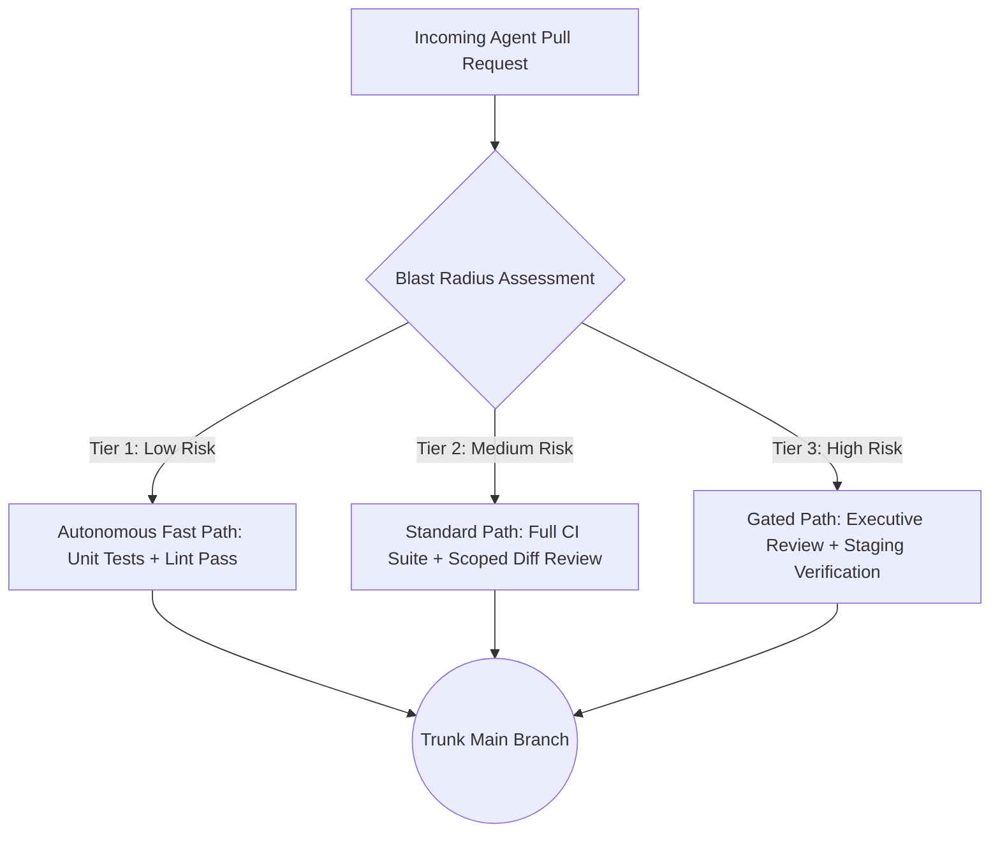

# Chapter 5 - Verification Strategy and Integration

In traditional development, testing was often treated as a late-stage tax that slowed down feature delivery. In aiXP, that dynamic inverts: when code generation costs approach zero, verification becomes the throughput of the pipeline.

Four practices structure testing and continuous integration into an automated verification engine:

- **The Verification Bottleneck:** Aligning development throughput with automated verification capacity.
- **The Four Testing Tiers:** Layering defenses from unit tests to schema contracts and hardware gates.
- **Continuous Integration and Risk-Tiered Merge Authority:** Calibrating merge rigor against blast radius.
- **Machine-Speed Regression Suites:** Converting bug reports into permanent, automated regression locks.

---

## The Verification Bottleneck

Eliyahu Goldratt's *Theory of Constraints* dictates that system throughput is governed strictly by its most constrained resource. Flooding a system upstream of its bottleneck produces inventory pileup, not finished goods.

### The Failure Mode

When engineers first adopt generative coding tools, initial focus centers on typing speed: scaffolding services, generating boilerplate, and opening massive pull requests. But without automated verification harnesses, downstream queues stall. Review backlogs swell, QA teams fall behind, and production regressions multiply. The team optimized code generation - which was never the bottleneck - and flooded the true constraint: human verification capacity.

### The Mechanism

In aiXP, verification and judgment are recognized as the primary constraints:

- **Tests are Throughput:** A fast, comprehensive automated test suite is the only mechanism that allows an engineer to safely merge high volumes of generated code.
- **Zero-Trust Generation:** All AI-generated output is treated as unverified candidate code until mechanical test harnesses prove it satisfies acceptance criteria.
- **Fast Feedback Loops:** Tests must execute in seconds, giving the human Navigator immediate, deterministic feedback before diffs are accepted into trunk.

---

## The Four Testing Tiers

Historically, maintaining a comprehensive multi-tier test ladder required dedicated QA teams that small shops could not justify. Automated test generation flattens this cost, making disciplined testing tiers practical for a solo engineer.

### The Ladder Architecture

1. **Unit Tests:** The smallest possible scope, testing isolated functions and pure logic. As detailed in [Chapter 3](03.00-terminal-loop.md), unit tests are written *before* implementation via Test-Driven Development (TDD) to drive AI generation.
2. **Integration Tests:** Verify that isolated components interact correctly across internal boundaries (e.g. verifying that a service properly queries the database layer or that an API controller returns the expected JSON envelope).
3. **Contract and Schema Tests:** Explicitly validate data payloads against defined schemas (OpenAPI, GraphQL, or Protobuf contracts). AI models excel at generating plausible code that subtly violates field names or nullable types; contract tests prevent these silent mismatches.
4. **End-to-End (E2E) and Perception-Gated Verification:** Validate user journeys across the full running stack. For visual or tactile interfaces where unit automation is impossible, verification shifts to human perception-gated passes and staged internal dogfooding.

---

## Continuous Integration and Risk-Tiered Merge Authority

In aiXP, Continuous Integration operates as a risk-tiered authority framework: the blast radius of a change dictates the verification gates required to merge it.

### The Failure Mode

If every trivial change requires a manual verification pass by the Navigator, development stalls. Conversely, if pull requests merge automatically based on shallow unit tests, regressions slip into trunk undetected.

### The Mechanism

aiXP adopts **Trunk-Based Development** paired with an explicit, three-tier merge authority model:

- **Tier 1 (Low Risk / Internal):** Pure documentation updates, typo fixes, or isolated internal refactors with complete test coverage. Fast-pathed through CI with lightweight spot review.
- **Tier 2 (Medium Risk / Functional):** Additive feature logic, new internal service endpoints, or dependency upgrades. Requires a full green CI run (unit + integration + contract) and a focused Navigator diff inspection.
- **Tier 3 (High Risk / Architectural):** Database schema migrations, authentication logic, payment processing, or public API contract mutations. Demands full CI, an independent Executive Code Review pass, and manual verification on an isolated preview environment before merge.

---

## Regression Suite Maintenance at Machine Speed

Every production bug represents an escaped defect that broke a verification assumption. A bug is only fixed when an automated reproduction test locks that defect out forever.

### The Failure Mode

In classic software engineering, regression suites suffered from gradual decay. Writing a regression test *after* diagnosing and patching a bug was tedious, unrewarded overhead. Developers under deadline pressure would patch the symptom, verify it manually once in a browser, and move to the next ticket. Over time, previously resolved defects quietly returned, eroding confidence in the test suite.

### The Mechanism

AI pairing removes the friction of regression testing:

- **Zero-Cost Test Generation:** When a production bug is identified, the Navigator prompts the AI to write a failing reproduction test *before* applying the fix.
- **Permanent Hardening:** Once the fix is applied and verified, the reproduction test permanently joins the automated regression suite.
- **Eliminating False Confirmatory Tests:** The Navigator must explicitly verify that the reproduction test fails against the unpatched code. A test that passes before the fix is applied is a hollow test that proves nothing.
