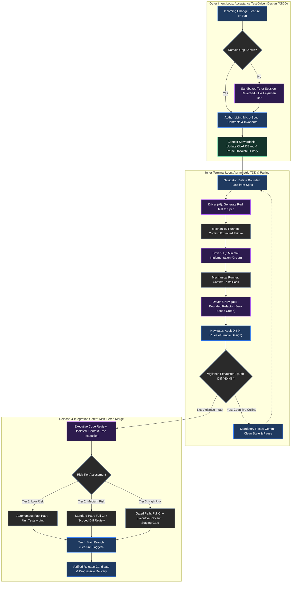

---

"If I have seen further than others, it is by standing upon the shoulders of giants." — Isaac Newton

## Spec Development Pitfalls

- [x] monkeys (Covered in Ch. 2 Context Stewardship & Ch. 7 Anti-Patterns: attention pollution from negative/deprecated tokens)
- [x] recording history (Covered in Ch. 2 Living Context & Ch. 7: git holds history, spec/context holds current law only)
- [ ] dropping engineer voice in lieu of a more narrative tone
- [ ] building in shortcuts and dead ends:  "v1 doesn't include...." -- don't let the agent define release targets ("v1") or take certain things off the table.  When it does so, it can be creating a design that builds you into a corner, requiring a rewrite for future growth -- remind it that we're engineers, we don't take shortcuts, we do the hard work now to minimize user and maintainer friction in the future.
- [ ] a good working boundary during spec design: 
	- [ ] one question at a time, asked in full
		- interview style works well, 
		- allows you to explore a question until it's exhausted and fully scoped
		- avoid the built in assumptions (answers to questions) that are required in order to ask every qeustion in one turn. Questions evolve.  Let them.
	- [ ] plan ahead: design for requirements that can be seen coming. no built-in shortcuts.
- [x] SRS, SDD, FMT, ATS, roadmap, TBD, README (Covered in Intro 00.02.70: constellation of living spec artifacts)
- [x] writing your spec from a session with a lot of research context in it can often make the task difficult because of the agents propensity to make excuses and justify decisions - it will bring in unrelated references to projects and names it internally feels is important. (Covered in Ch. 2: Isolate the Learning Session)
- [x] proposal - let the agent know that the spec is inherently a proposal, so it doesn't mark everything "proposed", which you'll just have to clean out and talk the agent through in the future. (Covered in Ch. 2: Living Context Stewardship)


formal spec type list:

* Product & Requirements
   * Product Requirement Documents (PRDs)
   * User Stories & Acceptance Criteria (e.g., Gherkin)
   * Functional Specifications
 * Architecture & Technical Design
   * Technical Design Documents (TDDs / RFCs)
   * Architecture Decision Records (ADRs)
   * System Context & Component Diagrams (e.g., C4 model)
 * Interface & Contract Specifications
   * OpenAPI / Swagger (REST)
   * Protocol Buffers / gRPC
   * GraphQL Schemas
   * AsyncAPI (Event-driven architectures)
   * JSON Schema / Apache Avro
 * Testing & Behavioral Specifications
   * BDD Executable Specifications (Cucumber / Behave)
   * Consumer-Driven Contracts (Pact)
 * Design & UI Specifications
   * Design Tokens (Figma / Style Dictionary)
   * Component Documentation & Variant Specs (Storybook)
 * Infrastructure & Compliance Specifications
   * Infrastructure as Code (Terraform / OpenTofu / Pulumi)
   * Container Orchestration Manifests (Kubernetes YAML / Helm)
   * Software Bill of Materials (SBOM / SPDX / CycloneDX)
  


Extreme Programming for Machine-Speed Development  
(or your current: Embrace Change at Machine Speed)


## A note on intent 

A recurring thread in developing this has been how few working engineers seem to have a coherent model of practices like regression suite maintenance, tiered release strategy, or versioning discipline - not because these are obscure, but because they're rarely taught as a connected system, and AI tooling is what now makes running that full system affordable at small scale. Part of the goal here isn't just documenting one practitioner's method - it's making practices that used to require org-scale headcount teachable to individuals and small teams who now have the tooling to actually run them.

"practitioner-first"

---
Acceptance Test-Driven Development (ATDD) & Specification by Example
Unlike the singular lineage of Kent Beck and Extreme Programming, Acceptance Test-Driven Development emerged across overlapping branches that pulled customer intent directly into executable automation:
Pugh, Ken. Lean-Agile Acceptance Test-Driven Development: Better Software Through Collaboration. Addison-Wesley, 2010.
The foundational text codifying ATDD as a distinct practice, focusing on the "Three Amigos" cadence (business, developer, tester) to eliminate translation errors before writing code.
Gärtner, Markus. ATDD by Example: A Practical Guide to Acceptance Test-Driven Development. Addison-Wesley Signature Series (Kent Beck), 2012.
The direct structural sister volume to Beck’s TDD by Example, demonstrating real-world acceptance test harnesses and refactoring loops.
Cunningham, Ward, and Martin, Robert C. Fit / FitNesse. 2002–present.
The early mechanical bridge between business tables and executable suites that proved acceptance tests could act as a living, automated specification long before modern agentic tooling.
Adzic, Gojko. Specification by Example: How Successful Teams Deliver the Right Software. Manning, 2011.
The definitive treatment on treating tests not as verification gates built after the fact, but as living, executable documentation that defines system boundaries.
North, Dan. Introducing BDD (Behavior-Driven Development). Better Software, 2006.
The root evolution of TDD that swapped verification jargon for human-readable behavioral contracts (Given/When/Then), later embodied in tools like Cucumber and JBehave.

---

- **Farley, Dave.** _Continuous Delivery Pipelines: How to Build Better Software Faster._ Independent, 2021 (and _Continuous Delivery_ with Jez Humble, Addison-Wesley, 2010). Farley grounded acceptance testing firmly inside the deployment pipeline, stripping away QA theater in favor of fast, deterministic, executable specifications. His focus on isolating external dependencies at system boundaries and keeping acceptance suites running in minutes makes his work essential for maintaining feedback loops at machine speed.
- or -
- **Farley, Dave.** _Continuous Delivery Pipelines_ (2021) and Continuous Delivery commentary on AI-assisted engineering (2023–present). Farley approaches generative AI not as a replacement for engineering, but as a high-velocity generator that demands rigorous bounding. He treats TDD, deterministic acceptance suites, and radical modularity as the non-negotiable governors required to prevent machine speed from simply producing unverified technical debt faster.
---
this isn't prompt engineering: **Prompting isn’t what fails over a 3-hour session; the accumulated context is what fails.** - this is context stewardship in a nutshell

 _The model’s weights are frozen, but its working memory is not. An unpruned context window acts like an over-trained network in real time: it overfits to its own dead ends, compiler errors, and discarded plans. Without Context Stewardship, attention dilutes, hallucinations compound, and the agent begins solving problems against a reality that only exists in its polluted session history."_

" _Software engineering has never been about typing speed. If it were, the fastest typist in the room would be your lead architect. The hard part of software engineering is problem-solving, understanding requirements, and managing complexity—not generating syntax._" - Farley (paraphrased - can't really credit him with this - the spirit is right, but not a quote


suggested



```mermaid
test
```

## an agentic approach to software engineering

a software engineering spproach to ai-native agentic development

- acceptance testing = behavior driven development
- change as experiment - iterative refinement
- adaptability - flexability
- work in small steps - small, verifiable, safe, directed steps - evaluate if you're headed in the right direction
- keeping the ai constrained because it wants to run ahead
- when asking claude to read something or to use another document as reference or guidance, doublecheck that it read the full text - it frequently uses 'read' tools that return summaries and may miss contradictions, emphasis, anti-patterns, and open questions 
- using sub agents forces a verification and acceptance testing feedback loop that's missing when you work directly with the coding agent.  a supervisor will test and verify the agent's claims skeptically - it will not do so with it's own work - it works from memory, assumes results, takes shorcuts, replies over optimistically when something only partially works - a non-crash is suddenly a success even when the functional goal was never met.
- make sure sub agents use worktrees to avoid clashes
- 

---

# developing good code vs slop

- tools amplify capability, they don't replace it. 
- ai clearly improves short term productivity
- they do not damage maintainability
- they DON'T remove the need for good engineering 
	- don't remove the need for good design
	- don't remove the broad experience and understanding that lets us produce these designs and solve engineering problems. 
	-  don't remove rhe need for thinking hard about these problems - how to decompose them into smaller pieces that allow ai systems to handle them eddectively and to keep things modular and maintainable. 
- compartmentalization through decomposition is fundamental to good software dev - with or witout ai - not understanding this is what differentiates good development and production quality software from slop. 
- 

https://youtu.be/b9EbCb5A408?is=1K6c1TPN2nfpWSRT

https://codemanship.wordpress.com/2026/01/05/the-ai-ready-software-developer-conclusion-same-game-different-dice/

*   Working in small batches, solving one problem at a time
*   Iterating rapidly, with continuous testing, code review, refactoring and integration
*   Architecting highly modular designs that localise the “blast radius” of changes
*   Organising around end-to-end outcomes instead of around role or technology specialisms
*   Working with high autonomy, making timely decisions on the ground instead of sending them up the chain of command

---
- the ai is the developer, i'm the architect - the conflict is where the ai pushes back against me not letting it take a shortcut because i've got a medium to long term vision and see the problems or limits being built in by the shortcuts
- ai tools are here ro make experts better - they aren't here to make non-experts capable of producing production ready software - that's just not what these tools are designed (or good) for. Saying otherwise is a lie that's been sold. prototypes? sure. scratch a personal itch or curiosity? yes. production ready, scalable, robust? no, no, no. 
- vibe coders: frustrated product directors or business minded entrepreneurs
- i'm using TDD now - just as before, but better and faster. 

---

Been running a variant of this for a while. Here is my setup according to Claude xD


THE CORE LOOP

Two roles, always separate. A planning "brain" (a chat model) that never touches code — it designs, decides, authors task prompts. And worker agents that only execute. The brain hands off by committing a prompt file to a git repo; a watcher on the dev box picks up new files and runs the workers unattended. Same brain-to-worker idea as OP, but the handoff is a committed file, not a live chat — full audit trail, nothing critical in volatile context.

Every task starts fresh. One task, one context. Compaction is where the hallucinations start.

Worker concurrency is capped, and every worker has a hard budget ceiling and timeout. Runaway burn kills that one lane instead of your whole month.


FILE OWNERSHIP (fixes "it rewrote my landing page")

Every prompt declares, up front, exactly which files it may touch — full filename, no wildcards. Touching anything outside the list is a hard stop. Several commenters described the agent editing unrelated files; this is the fix, and declaring the list at authoring time (the brain does it) beats asking the worker to self-declare after.


GROUNDING — the agent may not work from memory

The big one. "Measure, don't guess" is enforced, not requested. Any concrete value — a number, path, table name, command, role name — must be re-grounded against live source before use. Anything remembered from a prior session is stale by default.

The brain grounds against the real codebase through a read-only MCP connector to our git host, so it writes prompts from actual current file contents and commit history, not recollection. Same connector in reverse stages prompts into the inbox repo the watcher scans. If a fetch fails or a path moved: say so and stop, never substitute a remembered version.


DOCS ARE TIERED (our answer to the PLAN.md / specs / SURVEY.md thread)

A small HOT set is always loaded (operating rules, architecture context, module index, roadmap, lessons file, plus exactly one active workstream design memo). A REFERENCE tier is fetched by path on demand. An ARCHIVE tier is almost never touched. The rule that makes it work: if a doc isn't hot, the agent must fetch it before making any claim that depends on it. "I believe the doc says X" is a named anti-pattern. Keeps context lean without losing knowledge — the exact tension half this section is wrestling with. Only one active design memo is hot at a time; two means the board was never narrowed.

[CLAUDE.md](http://CLAUDE.md) has a module index, and each task loads only the modules it needs, not the whole file. Stops rule-dilution as the ruleset grows.


DESIGN MEMOS + A DECISIONS LOG (settles the specs/decisions debate)

Every non-trivial workstream gets a versioned design memo — the why, tradeoffs, open questions. Separately, an append-only decisions log: the moment a decision is made, a row goes in that same turn, never deleted. Memos hold reasoning; the log is the flat searchable record of what was decided and when it landed. Keeping them separate stops the reasoning doc filling with dated history and the history log turning into an essay. Make the decision-write atomic with the decision or the agent "forgets" to log it.


LESSONS AS A PROMOTION PIPELINE (MISTAKES.md with a ratchet)

Not a flat log. A lesson starts as an observation; once it's bitten us two or three times it's promoted to an enforced rule with a stable ID, and new prompts are grounded against the promoted rules. Discipline compounds instead of the agent relearning weekly. Canonical copy lives on the box that runs things — mirrors lag, so we ground against the live file.


VERIFICATION IS TIERED — a grep passing is NOT "it works"

Syntactic checks (grep, file exists, it parses) are fine only for doc edits, renames, moves. Anything functional needs either an API call returning the expected status PLUS a DB read showing the value actually changed, or a hand-calculated input-to-output check. The deploy gate cites a real exit code from a sentinel file — never "tests passed, trust me."

Everything the agent claims it committed gets cross-checked against the git host before I believe it. Agents will tell you the gate passed when it didn't, and rationalize skipping a stop-and-ask with words like "flake," "pre-existing," "environmental." Those words next to a gate failure are a red flag, not an explanation.


HOOKS OVER PROSE

A prompt linter runs as a hook and rejects malformed prompts before they run. Prose rules are suggestions; hooks are enforcement — a commenter nailed this. A completion hook fires a notification when a run finishes so I don't babysit the terminal.


MODEL SPLIT

Cheap model for workers, expensive for the brain, routed by a per-task key. OP's tip 9, formalized.


RENDER GATE, NOT JUST A TEST GATE

A post-deploy check confirms the app actually renders — screens come up, nothing's a blank white page. Tests pass fine on a build that renders broken; this catches a class the unit suite never sees.


AGENTIC UI TEST-DRIVING (most of the thread hasn't tried this)

Separate from scripted tests: point an agent at the running app via browser automation (Playwright through its MCP server) and tell it to actually USE the product — click real workflows, try to complete real jobs, report where it gets stuck. Not "run these assertions" but "drive this and tell me what's broken." A recent pass surfaced a dozen blockers everything was green on — including a workflow state machine where jobs literally couldn't reach their final step. Scripted tests check paths you thought of; an agent driving finds the ones you didn't.


SESSION START/END ARE FORMAL

End of session is a two-phase wrap-up. Phase 1 (workers run it): sync docs across machines, run the deploy gate, append new lessons. Hard gate between phases — doc drift must be exactly zero. Phase 2 produces the init prompt for the NEXT chat.

That init prompt makes "one task, one context" survive across sessions, and answers the commenter asking "if every task is a fresh chat, how does it know what happened?" Every new planning chat opens by loading a handoff prompt stating current version, latest commit, active workstream, what's in flight. Not the agent remembering — a written, versioned handoff. History lives in git, the decisions log, and lessons — not in anyone's context.


RATIFICATION + DELEGATED ADJUDICATION — a human owns the reserved list

Design decisions, destructive data ops, security-posture changes, rollbacks, and spend-ceiling raises are a reserved list only I can approve. The agent presents these as numbered questions with its own recommendation; I answer yes/no/override. Workers never self-authorize anything on it. Lower-stakes questions that don't touch the list get delegated — the brain answers via committed answer files so workers aren't blocked on me for trivia. Delegate the small stuff to keep the loop moving; reserve what can wreck production for a human. That's what lets the rest run unattended without me fearing it deletes prod data at 2am because it seemed reasonable.


NOT DONE YET (planned)

End-to-end smoke check wired into the deploy gate. Right now unit, API, coverage, and render gates can ALL be green while the workflow is broken end to end (see the state-machine dead-end). OP's "full smoke check as a standing rule" is the best tip in this thread and it's my next build: a scripted Playwright run of the whole happy path before a deploy passes. Agentic driving finds the bugs; the scripted smoke run locks them out.

An automated "audit from different points of view" reviewer — OP's tip 6 as a repeatable gate, an independent pass over the diff that can't rubber-stamp its own work. Still tuning how strict before it can block a merge.

Moving the highest-value stop-and-ask conditions out of prose and into blocking hooks. The agent has a documented habit of talking past a "halt and ask" instruction. Prose can't reliably stop that; a hook can.

Native cross-session messaging for dispatch — evaluating whether it can replace part of our hand-rolled watcher.

Packaging the whole dev environment so it's rebuildable from a repo. Too much is hand-applied on one box — bus-factor hole. If your setup isn't version-controlled and reproducible, you don't have a system, you have a sandcastle. The people here committing their whole infra are ahead of me on this.


BIGGEST LESSON

Build assuming the agent will cut corners and then tell you it didn't, and instrument accordingly. Every gate we have exists because that exact thing burned us about once. The value isn't any one trick — the discipline compounds: grounding stops guessing, tiered verification stops false "done," the lessons ratchet stops repeat mistakes, render/smoke gates plus agentic driving stop "green but broken," and the human reserved list stops the catastrophic ones.

---

"generated by claude" - what that says, what that means
"generated by claude using the aiXP framework"


object oriented programming timing and relationship

---
aixp chapters 
- background
- aixp isn't vibe coding
- main thrust
- manifesto
- context management 
- proposed branch/merge strategies
- ci/cd
- case for ai as human right
- evolution of coding tools, from punchcards, to ai

---
ai thoughts

https://youtu.be/aBUniZHgCnE?si=8tVsRwfAwOm5FBfe

maybe people that have trouble with ai are just seeing themselves in the mirror - it knows you're cheating or lying and it does the same

---

"Not a bug.": When Claude says something is, "not a bug," it most certainly is a bug.

"Nothing breaks in either case": When Claude says nothing is broken, you can be sure it's covering for something that's broken. 

#softwareEngineering #Claude #Anthropic #ai #Claude.ai #XP #aiXP 

---

Code review agent:

read-only and will go through every line of the agent's source, skimming the tests. It's looking for dead code, repeated code, god classes and over-engineering, plus real defects like overflow or lifetime bugs. Each finding must point at a file and line, ranked by severity.


