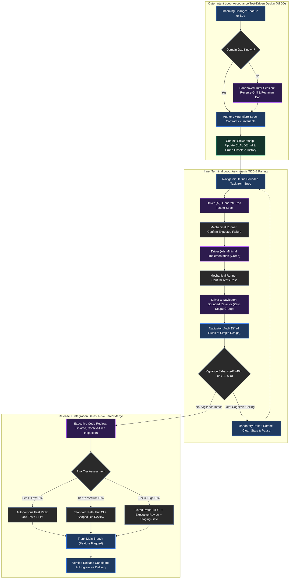

- maintainability
- fatique

---

question for every page:  is it telling a story, is it coherent, does it wander, does it make the reader want to continue, are there any threads i've left untouched?

"If I have seen further than others, it is by standing upon the shoulders of giants." — Isaac Newton

## Spec Development Pitfalls

- [ ]  monkeys
- [ ] recording history
- [ ] dropping engineer voice in lieu of a more narrative tone
- [ ] building in shortcuts and dead ends:  "v1 doesn't include...." -- don't let the agent define v1 or take certain things off the table.  When it does so, it can be creating a design that builds you into a corner, requiring a rewrite for future growth -- remind it that we're engineers, we don't take shortcuts, we do the hard work now to minimize user and maintainer friction in the future.
- [ ] a good working boundary during spec design: 
	- [ ] one question at a time, asked in full
		- interview style works well, 
		- allows you to explore a question until it's exhausted and fully scoped
		- avoid the built in assumptions (answers to questions) that are required in order to ask every qeustion in one turn. Questions evolve.  Let them.
	- [ ] no release boundaries invented by the agent.
	- [ ] plan ahead: design for requirements that can be seen coming. no built-in shortcuts.
- [ ] SRS, SDD, FMT, ATS, roadmap, TBD, README
- [ ] writing your spec from a session with a lot of research context in it can often make the task difficult because of the agents propensity to make excuses and justify decisions - it will bring in unrelated references to projects and names it internally feels is important.
- [ ] proposal - let the agent know that the spec is inherently a proposal, so it doesn't mark everything "proposed", which you'll just have to clean out and talk the agent through in the future.


formal spec type list:

* Product & Requirements
   * Product Requirement Documents (PRDs)
   * User Stories & Acceptance Criteria (e.g., Gherkin)
   * Functional Specifications
 * Architecture & Technical Design
   * Technical Design Documents (TDDs / RFCs)
   * Architecture Decision Records (ADRs)
   * System Context & Component Diagrams (e.g., C4 model)
 * Interface & Contract Specifications
   * OpenAPI / Swagger (REST)
   * Protocol Buffers / gRPC
   * GraphQL Schemas
   * AsyncAPI (Event-driven architectures)
   * JSON Schema / Apache Avro
 * Testing & Behavioral Specifications
   * BDD Executable Specifications (Cucumber / Behave)
   * Consumer-Driven Contracts (Pact)
 * Design & UI Specifications
   * Design Tokens (Figma / Style Dictionary)
   * Component Documentation & Variant Specs (Storybook)
 * Infrastructure & Compliance Specifications
   * Infrastructure as Code (Terraform / OpenTofu / Pulumi)
   * Container Orchestration Manifests (Kubernetes YAML / Helm)
   * Software Bill of Materials (SBOM / SPDX / CycloneDX)
  


Extreme Programming for Machine-Speed Development  
(or your current: Embrace Change at Machine Speed)


## A note on intent 

A recurring thread in developing this has been how few working engineers seem to have a coherent model of practices like regression suite maintenance, tiered release strategy, or versioning discipline - not because these are obscure, but because they're rarely taught as a connected system, and AI tooling is what now makes running that full system affordable at small scale. Part of the goal here isn't just documenting one practitioner's method - it's making practices that used to require org-scale headcount teachable to individuals and small teams who now have the tooling to actually run them.

"practitioner-first"

---
Acceptance Test-Driven Development (ATDD) & Specification by Example
Unlike the singular lineage of Kent Beck and Extreme Programming, Acceptance Test-Driven Development emerged across overlapping branches that pulled customer intent directly into executable automation:
Pugh, Ken. Lean-Agile Acceptance Test-Driven Development: Better Software Through Collaboration. Addison-Wesley, 2010.
The foundational text codifying ATDD as a distinct practice, focusing on the "Three Amigos" cadence (business, developer, tester) to eliminate translation errors before writing code.
Gärtner, Markus. ATDD by Example: A Practical Guide to Acceptance Test-Driven Development. Addison-Wesley Signature Series (Kent Beck), 2012.
The direct structural sister volume to Beck’s TDD by Example, demonstrating real-world acceptance test harnesses and refactoring loops.
Cunningham, Ward, and Martin, Robert C. Fit / FitNesse. 2002–present.
The early mechanical bridge between business tables and executable suites that proved acceptance tests could act as a living, automated specification long before modern agentic tooling.
Adzic, Gojko. Specification by Example: How Successful Teams Deliver the Right Software. Manning, 2011.
The definitive treatment on treating tests not as verification gates built after the fact, but as living, executable documentation that defines system boundaries.
North, Dan. Introducing BDD (Behavior-Driven Development). Better Software, 2006.
The root evolution of TDD that swapped verification jargon for human-readable behavioral contracts (Given/When/Then), later embodied in tools like Cucumber and JBehave.

---

- **Farley, Dave.** _Continuous Delivery Pipelines: How to Build Better Software Faster._ Independent, 2021 (and _Continuous Delivery_ with Jez Humble, Addison-Wesley, 2010). Farley grounded acceptance testing firmly inside the deployment pipeline, stripping away QA theater in favor of fast, deterministic, executable specifications. His focus on isolating external dependencies at system boundaries and keeping acceptance suites running in minutes makes his work essential for maintaining feedback loops at machine speed.
- or -
- **Farley, Dave.** _Continuous Delivery Pipelines_ (2021) and Continuous Delivery commentary on AI-assisted engineering (2023–present). Farley approaches generative AI not as a replacement for engineering, but as a high-velocity generator that demands rigorous bounding. He treats TDD, deterministic acceptance suites, and radical modularity as the non-negotiable governors required to prevent machine speed from simply producing unverified technical debt faster.
---
this isn't prompt engineering: **Prompting isn’t what fails over a 3-hour session; the accumulated context is what fails.** - this is context stewardship in a nutshell

 _The model’s weights are frozen, but its working memory is not. An unpruned context window acts like an over-trained network in real time: it overfits to its own dead ends, compiler errors, and discarded plans. Without Context Stewardship, attention dilutes, hallucinations compound, and the agent begins solving problems against a reality that only exists in its polluted session history."_

" _Software engineering has never been about typing speed. If it were, the fastest typist in the room would be your lead architect. The hard part of software engineering is problem-solving, understanding requirements, and managing complexity—not generating syntax._" - Farley (paraphrased - can't really credit him with this - the spirit is right, but not a quote


suggested



```mermaid
test
```

## an aeentic approach to software engineering

a software engineering spproach to ai-native agentic development

- acceptance testing = behavior driven development
- change as experiment - iterative refinement
- adaptability - flexability
- work in small steps - small, verifiable, safe, directed steps - evaluate if you're headed in the right direction
- keeping the ai constrained because it wants to run ahead
- when asking claude to read something or to use another document as reference or guidance, doublecheck that it read the full text - it frequently uses 'read' tools that return summaries and may miss contradictions, emphasis, anti-patterns, and open questions 
- using sub agents forces a verification and acceptance testing feedback loop that's missing when you work directly with the coding agent.  a supervisor will test and verify the agent's claims skeptically - it will not do so with it's own work - it works from memory, assumes results, takes shorcuts, replies over optimistically when something only partially works - a non-crash is suddenly a success even when the functional goal was never met.
- make sure sub agents use worktrees to avoid clashes
- 

---

# developing good code vs slop

- tools amplify capability, they don't replace it. 
- ai clearly improves short term productivity
- they do not damage maintainability
- they DON'T remove the need for good engineering 
	- don't remove the need for good design
	- don't remove the broad experience and understanding that lets us produce these designs and solve engineering problems. 
	-  don't remove rhe need for thinking hard about these problems - how to decompose them into smaller pieces that allow ai systems to handle them eddectively and to keep things modular and maintainable. 
- compartmentalization through decomposition is fundamental to good software dev - with or witout ai - not understanding this is what differentiates good development and production quality software from slop. 
- 

https://youtu.be/b9EbCb5A408?is=1K6c1TPN2nfpWSRT

https://codemanship.wordpress.com/2026/01/05/the-ai-ready-software-developer-conclusion-same-game-different-dice/

*   Working in small batches, solving one problem at a time
*   Iterating rapidly, with continuous testing, code review, refactoring and integration
*   Architecting highly modular designs that localise the “blast radius” of changes
*   Organising around end-to-end outcomes instead of around role or technology specialisms
*   Working with high autonomy, making timely decisions on the ground instead of sending them up the chain of command

---
- the ai is the developer, i'm the architect - the conflict is where the ai pushes back against me not letting it take a shortcut because i've got a medium to long term vision and see the problems or limits being built in by the shortcuts
- ai tools are here ro make experts better - they aren't here to make non-experts capable of producing production ready software - that's just not what these tools are designed (or good) for. Saying otherwise is a lie that's been sold. prototypes? sure. scratch a personal itch or curiosity? yes. production ready, scalable, robust? no, no, no. 
- vibe coders: frustrated product directors or business minded entrepreneurs
- i'm using TDD now - just as before, but better and faster. 
