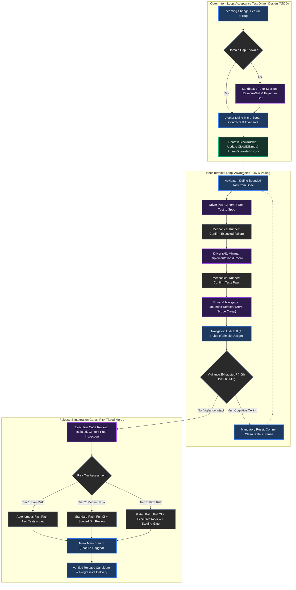

# Field Protocol: The Loop in Practice (Draft Archive)

> [!NOTE] Archive Note
> This is the initial checklist/spec-oriented draft of the Field Protocol, preserved as a reference for future runbook/checklist extraction (e.g. for an appendix or cheat sheet).

The preceding chapters established the principles of aiXP: grounding intent before generation, pairing asymmetrically at the terminal, budgeting human vigilance, and enforcing fractal contracts that govern what, not how.

Yet on a Monday morning, an engineer sitting at a terminal does not need abstract theory. They need an operational runbook. They need to know what commands to run, how to structure their terminal sessions without context bleed, when to transition a micro-spec, and how to shepherd a single ticket from user report to production trunk without burning out.

This chapter is that field runbook.

---

## 1. The Unified Loop

The aiXP workflow operates as two nested feedback loops protected by release gates:



### The Dynamics Between the Loops
- **The Outer Intent Loop** runs at human speed. It handles problem definition, invariant formulation, domain education, and context hygiene. It ensures you do not write code for a hallucinated requirement.
- **The Inner Terminal Loop** runs at machine speed. It cycles through Red, Green, and Refactor in round-trips measured in minutes.
- **The Release Gates** act as the circuit breakers. They protect trunk from vigilance fatigue, attention bias, and unreviewed scope sprawl.

---

## 2. The Micro-Spec Lifecycle

In traditional development, specifications are static monuments written before work begins. In aiXP, a micro-spec is an active state machine:

```
[DRAFT] ---> [ACTIVE] ---> [SATISFIED] ---> [SUPERSEDED]
```

| State | Trigger | Operational Rule |
| :--- | :--- | :--- |
| **`DRAFT`** | Incoming ticket, issue, or feature request. | Written in `notes/specs/`. Explores invariants, boundaries, and non-goals. May involve a sandboxed reverse-grill session. No production code allowed. |
| **`ACTIVE`** | Navigator formally accepts criteria. | The micro-spec becomes the binding ATDD contract. The Lead Agent breaks it into bounded tasks for the Driver. The spec is locked: the Driver cannot alter it. |
| **`SATISFIED`** | Mechanical test suite passes; Executive Review clean. | All acceptance criteria verified by automated tests or explicit sign-offs. Committed alongside the implementation to record provenance. |
| **`SUPERSEDED`** | System evolves; requirements change. | When a feature is altered or deprecated, the old spec is never silently rewritten in place. A new micro-spec is created, marking the previous one superseded with a link to the new revision. |

---

## 3. Terminal Mechanics: Running the Topology Solo

The Agent Role Topology (Lead Agent, Scoped Implementer, Executive Reviewer) sounds complex, but in practice a solo engineer runs it from a single laptop using simple terminal hygiene.

### The Two-Terminal Pattern

To prevent context pollution, run two distinct terminal panes or windows:

1. **Terminal 1: The Context Orchestrator (Lead Session)**
   - Holds repository context, architectural guidelines, and the active micro-spec.
   - Responsible for task decomposition, test runner monitoring, and commit structuring.
   - **Strict Rule:** Never allows the Lead session to write implementation code directly. Its job is navigation and task dispatch.

2. **Terminal 2: The Scoped Implementer (Worker Session)**
   - Launched either as a fresh CLI invocation (or an isolated subagent) with a scoped task definition.
   - Receives only three inputs:
     1. The path to the relevant files.
     2. The exact acceptance criteria or failing test.
     3. Explicit non-goals (what *not* to touch).
   - Once the test passes and the diff is committed, this session is terminated or cleared.

### Briefing "What, Not How" to Preserve the Second Opinion

When briefing the Scoped Implementer from the Lead session, enforce Pillar 3 with iron discipline. 

**The Antipattern (How-First):**
> *"Fix the worker timeout. Write a loop in `worker.py` that increments an integer counter `retry_count` up to 3, and add a `time.sleep(2)` between calls."*
> 
> *Result:* The implementer mimics the supervisor's exact procedural instructions, misses the async event loop constraint, and locks the thread.

**The aiXP Brief (What-First):**
> *"Implement retry handling for `WorkerTask` according to `notes/specs/task-retry-spec.md`. The task must retry up to 3 times with exponential backoff before routing to the dead-letter queue. Do not block the event loop. Write the failing test in `tests/test_worker_retry.py` first. Do not touch `queue_manager.py`."*
> 
> *Result:* The implementer discovers an existing exponential-backoff utility in the codebase, writes a clean non-blocking async handler, and turns the test green.

### The Supervisor Audit Prompt
When the implementer finishes and returns a branch or diff, the Navigator issues a standard check to the Lead Agent:

> *"Review the diff in branch `feat/worker-retry`. Was the implementation in any way surprising, or did it merely conform to what you expected? Did it introduce any unnecessary moving parts?"*

This forces the Lead Agent to evaluate the code as an independent reviewer, probing for novel efficiencies or hidden invariant violations.

### The Context-Free Executive Review
Before merging any Tier 2 or Tier 3 change, run an executive review. This **must** be executed in a completely fresh session with zero conversational memory:

```bash
# Example invocation using Claude Code in non-interactive print mode:
git diff main...HEAD | claude -p \
  "You are an independent Executive Code Reviewer. You have zero access to conversational history or design specs.
   Audit this raw diff line by line. Report only:
   1. Unhandled edge cases, nil/null pointer risks, or unhedged exceptions.
   2. Violations of Simple Design: unnecessary abstractions, unused helpers, or dead code paths.
   3. Architectural scope creep outside the obvious intent of the diff."
```

If the Executive Reviewer cannot understand what the code does from the diff alone, the code fails the comprehensibility test.

---

## 4. The 7-Step Desk Runbook

Keep this checklist beside your keyboard. For every non-trivial change, step through sequentially:

- [ ] **Step 1: Ingest & Gap Check**
  - Read the bug report or user request.
  - Can you explain the domain rules and failure modes without hand-waving?
  - *If no:* Open an isolated sandbox session. Run the Feynman Reverse-Grill until domain mechanics are clear.

- [ ] **Step 2: Draft the Micro-Spec**
  - Create `notes/specs/TICKET-spec.md`.
  - State the contract: Inputs, Outputs, Invariants, and explicit Non-Goals.
  - Mark status as `DRAFT`. Review and promote to `ACTIVE`.

- [ ] **Step 3: Context Sync**
  - Review `CLAUDE.md` and repository instructions.
  - Are there obsolete conventions or outdated tool commands? Clean them now.
  - Ensure the active session context is compact and high-signal.

- [ ] **Step 4: The Inner Loop (Red -> Green -> Refactor)**
  - *Red:* Prompt the Driver to write the test asserting the micro-spec. Run the test harness mechanically. Verify it fails with the expected failure message.
  - *Green:* Prompt the Driver for the minimal implementation that passes the test. Run the runner. Verify green.
  - *Refactor:* Prompt a bounded refactoring pass to remove duplication and clarify intent. Re-verify green.

- [ ] **Step 5: Vigilance Audit**
  - Check the diff volume (`git diff --stat`) and session duration.
  - Have you audited more than 40 diffs or worked for 60 continuous minutes?
  - *If yes:* Trigger a mandatory pause. Commit the clean green state to a feature branch. Step away from the screen for 10 minutes.

- [ ] **Step 6: Context-Free Executive Review**
  - Pipe the branch diff into a clean, stateless agent session.
  - Address valid findings: missing edge cases or unnecessary moving parts.
  - If a fix is required, add a test assertion to the spec and rerun Step 4.

- [ ] **Step 7: Risk-Tiered Merge**
  - Evaluate risk tier (Tier 1: Fast path; Tier 2: Full CI; Tier 3: Staging + feature flag).
  - Run the full regression test suite locally or via CI pipeline.
  - Merge to trunk. Mark micro-spec as `SATISFIED`.

---

## 5. End-to-End Case Study: The 64KB Dead-Letter Payload Bug

To see this protocol under realistic conditions, we follow a single production bug through all seven steps.

### The Raw Bug Report
A user files an issue on an internal job-queue service:
> *"Worker queue drops tasks silently when the payload is large or contains emojis."*

---

### Step 1 & 2: Ingest and Micro-Spec Drafting

The Navigator investigates the service logs and identifies the problem: tasks with JSON payloads over 64KB or containing 4-byte UTF-8 characters cause the serialization parser to throw an uncaught exception, dropping the message without routing it to the dead-letter queue.

The Navigator drafts `notes/specs/task-serialization-spec.md`:

```markdown
# Micro-Spec: Worker Task Serialization & Dead-Letter Safety
Status: ACTIVE
Date: 2026-11-04

## Problem Statement
Task payloads exceeding 64KB or containing 4-byte UTF-8 characters cause unhandled parser 
exceptions in `TaskReceiver.ingest()`, causing messages to be dropped without dead-letter routing.

## Contracts & Invariants
1. `TaskReceiver.ingest()` must accept payloads up to 1MB without truncation.
2. Any payload containing arbitrary UTF-8 characters (including emojis and 4-byte symbols) 
   must deserialize cleanly.
3. If a payload is unparseable (e.g. malformed binary or corrupted JSON), it must NEVER be dropped. 
   It must be routed to `DeadLetterQueue.publish()` with failure metadata.
4. Payload size exceeding 1MB must immediately raise `PayloadTooLargeError` and route to dead-letter.

## Non-Goals
- Do not refactor the transport layer (`RabbitMQTransport`).
- Do not modify database ingestion schemas.
```

---

### Step 3: Context Sync
The Navigator checks `CLAUDE.md`. The test runner command is verified:
```bash
pytest tests/test_task_receiver.py -v
```

---

### Step 4: Inner Loop Turns

#### 1. Red (Prompting the Failing Test)
The Navigator briefs the AI Driver in Terminal 2:

> *"Read `notes/specs/task-serialization-spec.md`. In `tests/test_task_receiver.py`, write failing tests covering Invariants 1, 2, and 3: a 128KB payload, a 4-byte UTF-8 string with surrogate pairs, and a corrupted JSON string. Do not touch production code."*

The Driver outputs the test code. The Navigator runs the mechanical test suite:

```bash
$ pytest tests/test_task_receiver.py -k "test_payload" -v
============================= test session starts ==============================
tests/test_task_receiver.py::test_large_payload_ingest FAILED            [ 33%]
tests/test_task_receiver.py::test_utf8_emoji_payload FAILED             [ 66%]
tests/test_task_receiver.py::test_corrupted_payload_routed_to_dlq FAILED [100%]

=================================== FAILURES ===================================
___________________________ test_large_payload_ingest __________________________
    def test_large_payload_ingest():
        receiver = TaskReceiver()
>       result = receiver.ingest(generate_payload(size_kb=128))
E       BufferOverflowError: Payload exceeds hard buffer limit (65536 bytes)

=========================== 3 failed in 0.42s ==================================
```

**Mechanical verification confirmed:** Three distinct tests failed with the exact expected diagnostics.

#### 2. Green (Minimal Implementation)
The Navigator prompts the Driver:

> *"Implement the minimal fix in `src/receiver.py` to satisfy `notes/specs/task-serialization-spec.md`. Expand the internal buffer envelope to 1MB, ensure UTF-8 safe decoding, and wrap the parse call in a dead-letter fallback. Do not add helper classes or refactor other methods."*

The Driver modifies `src/receiver.py`. The Navigator runs the test harness:

```bash
$ pytest tests/test_task_receiver.py -k "test_payload" -v
============================= test session starts ==============================
tests/test_task_receiver.py::test_large_payload_ingest PASSED            [ 33%]
tests/test_task_receiver.py::test_utf8_emoji_payload PASSED             [ 66%]
tests/test_task_receiver.py::test_corrupted_payload_routed_to_dlq PASSED [100%]

============================== 3 passed in 0.18s ===============================
```

#### 3. Bounded Refactor
The Navigator inspects the diff:
```diff
--- a/src/receiver.py
+++ b/src/receiver.py
@@ -14,12 +14,18 @@ class TaskReceiver:
-    def ingest(self, raw_bytes: bytes) -> Task:
-        if len(raw_bytes) > 65536:
-            raise BufferOverflowError("Payload exceeds hard buffer limit")
-        payload_str = raw_bytes.decode('ascii')
-        return Task.from_json(json.loads(payload_str))
+    MAX_PAYLOAD_BYTES = 1024 * 1024  # 1MB
+
+    def ingest(self, raw_bytes: bytes) -> Optional[Task]:
+        if len(raw_bytes) > self.MAX_PAYLOAD_BYTES:
+            self.dlq.publish(raw_bytes, reason="PAYLOAD_TOO_LARGE")
+            return None
+        try:
+            payload_str = raw_bytes.decode('utf-8', errors='replace')
+            return Task.from_json(json.loads(payload_str))
+        except Exception as err:
+            self.dlq.publish(raw_bytes, reason=f"PARSE_ERROR: {str(err)}")
+            return None
```

The Navigator notices that `errors='replace'` would silently alter corrupted data before publishing to the dead-letter queue, violating raw payload preservation.

The Navigator prompts a bounded adjustment:
> *"In `src/receiver.py`, decode with strict `utf-8`. If decoding fails, catch `UnicodeDecodeError` and route raw untouched bytes to DLQ with reason `ENCODING_ERROR`."*

The suite is rerun. All tests pass cleanly.

---

### Step 5: Vigilance Audit
The session diff is compact (+18 / -5 lines across two files). The session duration is 14 minutes. Vigilance is fully intact.

---

### Step 6: Context-Free Executive Review
The Navigator pipes the branch diff to a fresh, stateless agent:

```bash
git diff main...HEAD | claude -p "Audit this diff context-free for edge cases and Simple Design."
```

**Executive Reviewer Output:**
> *"Code is clean, minimal, and reveals intent. One observation: in `ingest()`, catching bare `Exception` masks system-level interruptions (`KeyboardInterrupt`, `SystemExit`). Suggest catching `json.JSONDecodeError` and `UnicodeDecodeError` specifically."*

The Navigator recognizes this as a valid catch. The exception handling is tightened to specific exceptions. The test suite is re-executed.

---

### Step 7: Risk-Tiered Merge

- **Risk Assessment:** Tier 2 (Core message ingestion path).
- **Gate:** Full test suite execution + linting:
  ```bash
  pytest && flake8 && mypy src/
  ```
- **Commit & Merge:**
  ```bash
  git commit -m "fix(ingest): handle 1MB payloads, utf-8 encoding, and dlq routing"
  git push origin main
  ```
- **Spec Closure:** In `notes/specs/task-serialization-spec.md`, the status is updated:
  ```markdown
  Status: SATISFIED (Commit: 8f2b10a)
  ```

---

## The Takeaway

This is the entire discipline executed in thirty minutes:
- No vibe coding.
- No wandering agent hallucinations.
- No line-by-line pseudocode micromanagement.
- No unhedged changes entering trunk.

By grounding intent in a micro-spec, enforcing strict asymmetric TDD, preserving human vigilance, and verifying independently before merge, machine speed produces **zero-drama, production-grade software.**
